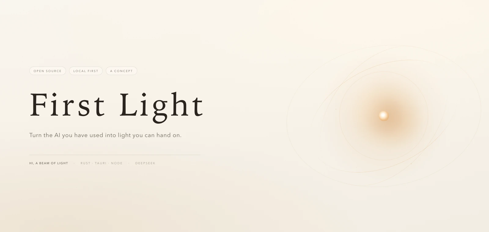
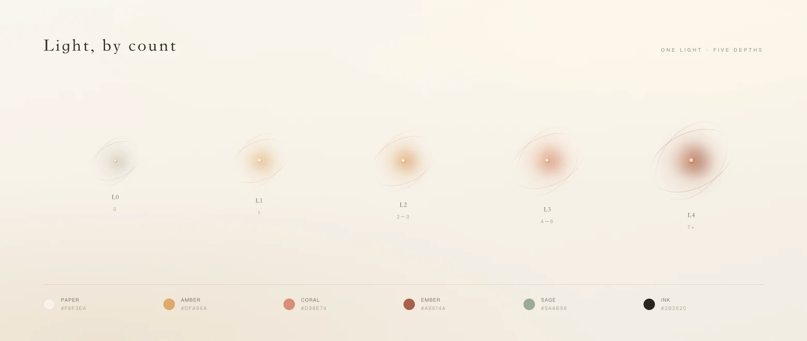
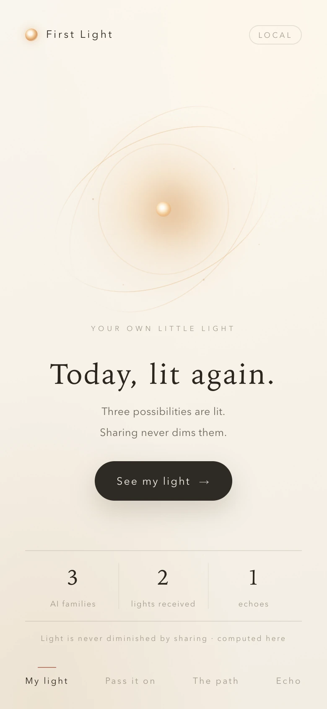
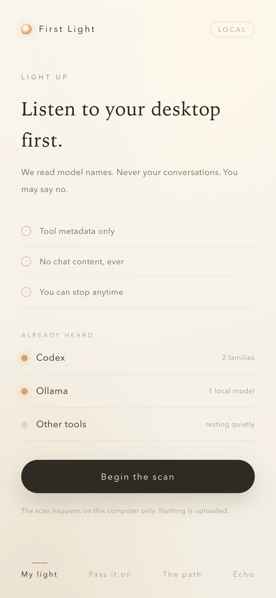
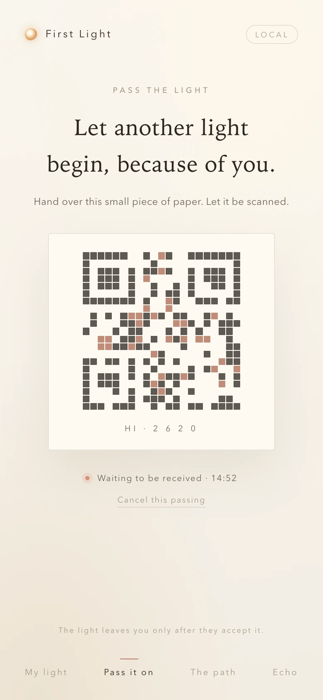
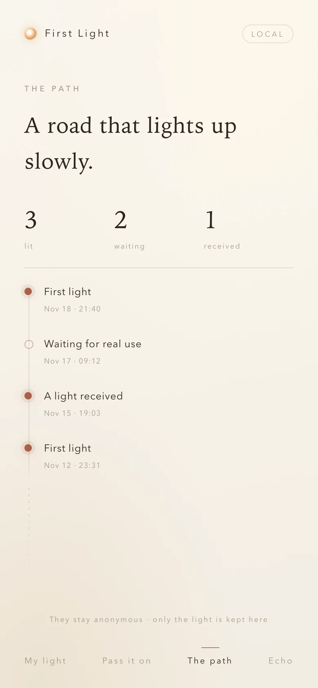
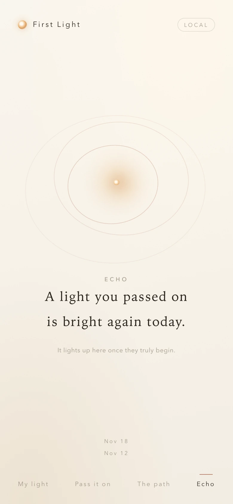
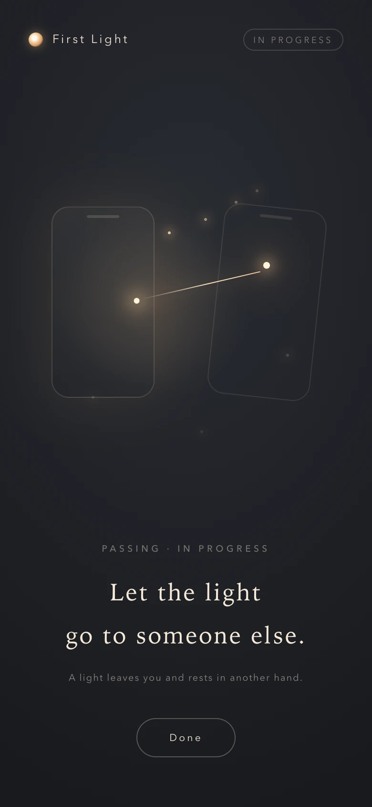

<p align="center">
  
</p>

<h1 align="center">First Light</h1>

<p align="center">
  <em>Turn the AI you have used into light you can hand on.</em>
</p>

<p align="center">
  <a href="README.md">中文</a> ·
  <b>English</b> ·
  <a href="README.fr.md">Français</a> ·
  <a href="README.ja.md">日本語</a>
</p>

<p align="center">
  
  
  
  
  
</p>

<p align="center">
  <sub>Topics: <code>deepseek</code> · <code>deepseek-harness</code> · <code>local-first</code> · <code>privacy</code> · <code>tauri</code> · <code>rust</code> · <code>healing-ui</code></sub>
</p>

> Light is not diminished by sharing.

---

## What this is

**First Light** is a concept system for an “AI capability transmission network” — and a working implementation of one.

It does three things:

1. **Light up.** On your own computer it reads only the metadata left by AI clients — model names, whether a session actually produced anything — and turns “how many kinds of AI have you really used” into a single light. More verified families, deeper light.
2. **Pass it on.** Hand that light to another person. Not an account, not a quota, not a referral: an invitation that says “I'll start with you.”
3. **Echo.** Only when the other person actually begins to use it does a light appear on your side. Being helped becomes visible for the first time.

It does not rank people, score them, or compare their worth. **Light stands for capability, never for a person's value.**

---

## Why it exists

Everything today measures who uses more. Leaderboards brighten the people who already know, and dim the people who are just starting.

First Light uses measurement the other way round: **not how well you used it, only that you began; not who is ahead, only who passes it on.**

- You have used GPT, and a local Ollama model — two layers of light.
- You pass the light to a friend; your own light does not lose a single layer.
- The friend really begins; one echo appears here.

“One person starts, more people happen.” That is the only goal of this system.

---

## How it works



**1. A local scan.**
Only the metadata tables of AI clients, and only the columns on a whitelist. The scan runs on your machine; nothing is uploaded.
No chat bodies, no prompts, no attachments, no screenshots.

**2. Family normalisation.**
Values like `gpt-4o`, `o3`, `codex-mini` are mapped to families through a versioned dictionary.
Measured: of 9 distinct model values, only **1 was a real family**; `codex-auto-review` is an internal task label, not a model.
Look up, never infer — naive counting turns 1 family into 9.

**3. Two gates.**
“A model was named” is not enough. The model is written when a session is created; 78 of 347 sessions had `tokens_used = 0`.
So there is a second gate: did the session actually contain model output?
Measured: 347 sessions → 140 pass both gates → **1 family**.

**4. Light levels.**
Only families that pass both gates deepen the core.

| Level | Verified families | What the light looks like |
| :-- | :-- | :-- |
| Dormant | 0 | A dust mote of clay grey |
| Faint | 1 | A single point of amber |
| Growing | 2–3 | Warm gold, a mist begins |
| Blazing | 4–6 | Coral, a wider halo |
| Deep | 7+ | Ember, the heaviest layer |

**5. Passing and echo.**
Initiate → the other person scans a code or taps a tag → they accept → both sides confirm → activation uses **their own device's** evidence → one echo reaches you.
The server only ever sees an anonymous identity and a state. Never chat content, never model details.

---

## The interface: one sheet of paper, one light

This interface language is called **Warm Paper, Faint Light**: unbleached warm paper, 1px hairlines, one breathing light, one sentence that does not hurry you.
No dashboard, no progress bar, no numbers turned into medals.

<table>
  <tr>
    <td align="center" width="33%"><br><sub><b>My light</b> · Today, lit again.</sub></td>
    <td align="center" width="33%"><br><sub><b>Light up</b> · Listen to your desktop first.</sub></td>
    <td align="center" width="33%"><br><sub><b>Pass the light</b> · A small piece of paper.</sub></td>
  </tr>
  <tr>
    <td align="center" width="33%"><br><sub><b>The path</b> · A road that lights up slowly.</sub></td>
    <td align="center" width="33%"><br><sub><b>Echo</b> · The emptiest page.</sub></td>
    <td align="center" width="33%"><br><sub><b>The passing</b> · The only dark screen.</sub></td>
  </tr>
</table>

Three hard rules:

- **The light is quiet.** Only four verbs: seep, breathe, spread, glow. Never more than three moving elements on a screen.
- **Paper is the ground.** Warm paper `#F8F3EA` with 3.5% grain; separators are 1px lines at 11% opacity.
- **Empty space is content.** At least 40% of a screen is empty. It is not unfinished; it is room to breathe.

Full colour, light level parameters, layout and motion rules: [`design/healing/README.md`](design/healing/README.md) (Chinese).
The interactive prototype is [`design/healing/index.html`](design/healing/index.html).

---

## Privacy boundary

This is the most serious part of the project, and the part most worth reading.

**1. The boundary is column-level, not file-level.**
In a real client, `threads.model` is usable evidence and `threads.first_user_message` is the user's own words — **in the same file, the same table.**
So “we do not read chat bodies” is not a promise. It is a column allowlist, a global deny list, a single data-access path, and a runtime audit.

**2. Read-only, and out of the way.**
Databases are opened with `SQLITE_OPEN_READ_ONLY` and `immutable=1`: no locks, no writes, no interference.

**3. Self-attestation does not count.**
You may tick “I have used Claude”. It is recorded as E2 only: it never deepens the core, never raises the title.

**4. Data stays home.**
Computed locally, stored locally (SQLite), key kept in the system keychain. The only network traffic is the invitation itself, carrying an anonymous identity and a state.

> Full audit: `docs/security/`, `docs/reports/privacy-audit.md`, `docs/reports/f2-privacy-audit.md`.
> 21 negative tests are recorded in the acceptance reports.

---

## Architecture

```
┌──────────────────────────────────────────────────────────────┐
│ Clients                                                       │
│  Desktop, Tauri 2 (macOS)   Browser preview   WeChat mini app │
└───────────────┬──────────────────┬───────────────────────────┘
                │                  │
┌───────────────▼──────────────────▼───────────────────────────┐
│ Rust core (no I/O)                                            │
│   light-core    identity / registry / evidence / level / FSM  │
│   adapter-sdk   column allowlist + deny list + one read path  │
│   adapter-codex two-gate evidence (measured on real data)     │
│   adapter-ollama local model evidence                         │
│   light-store   local SQLite (offline, schema v1 + migrations)│
└───────────────┬──────────────────────────────────────────────┘
                │ Ed25519 signatures / HTTPS
┌───────────────▼──────────────────────────────────────────────┐
│ Server: Node 24 + Hono + PostgreSQL (PGlite in tests)         │
│   invite / mutual confirm / activate / echo; FSM; anti-replay │
└──────────────────────────────────────────────────────────────┘
```

| Path | Contents |
| :-- | :-- |
| `crates/light-core` | Pure core: identity, registry, evidence, levels, titles, state machine, protocol (no I/O) |
| `crates/adapter-sdk` | Column-level controlled access + global deny list |
| `crates/adapter-codex`, `adapter-ollama` | The two real adapters |
| `crates/light-store` | Local SQLite storage and migrations |
| `apps/desktop` | Tauri desktop: transparent floating light + four-screen panel |
| `apps/browser-preview` | Browser acceptance build: opening, home, passing, real map, private notes |
| `apps/wechat-miniprogram` | Native WeChat mini program source |
| `services/api` | Passing server: invite, confirm, activate, echo |
| `packages/protocol` | 11 JSON Schemas + shared fixtures + an independent TypeScript reference |
| `data/model-registry.v1.json` | Versioned model family dictionary (data, not code) |
| `docs/adr` | 12 architecture decision records, each naming what it rejected |
| `design/healing` | This healing interface: prototype, motion, render scripts |

Dependencies point one way only: `light-core` depends on nothing else; adapters may never depend on server logic.

---

## Where it stands

What this repository wants to give you is not “done”, but **checkable honesty**. Every status has a command and an output in `docs/reports/`.

| Capability | Status |
| :-- | :-- |
| Model family normalisation | Tested |
| E0–E4 evidence levels + two gates | Tested (measured on real data) |
| Column-level privacy boundary | Tested (21 negative tests) |
| Anonymous identity, key rotation, recovery code | Tested |
| Levels / two title ladders / protocol parity | Tested (Rust ↔ TypeScript both ways) |
| Passing state machine and server | Tested (T1–T15) |
| Desktop transparent light (macOS) | Verified (pixel-level evidence) |
| Desktop two-instance passing loop | Integrated |
| Browser acceptance build (opening / passing / map) | Implemented, runs locally |
| WeChat mini program | Source synced, not device-verified |
| Windows / iOS / Android | Not done |
| NFC hardware, public deployment | Not done (no hardware, no domain) |

Test record: **229 automated tests** (188 Rust + 12 protocol + 29 server) + **14 desktop end-to-end**.
See `docs/reports/test-execution.md`. Numbers are a record, not a promise; rerun them on your own machine.

---

## Quick start

```bash
# 1. Just the interface (Python 3, no front-end install)
python3 tools/launch/launch_preview.py     # http://127.0.0.1:8897

# 2. Rust core (no network, no database)
cargo test

# 3. Cross-language protocol parity
cd packages/protocol && node --test test/conformance.test.mjs

# 4. Passing server
cd services/api && node --test test/*.test.mjs
```

The browser build is a simulation: scanning and passing can be clicked, but it never reads your computer.
The real desktop app is built with Tauri, and its window behaviour was verified on macOS.

---

## Where to start reading

| You want | Read |
| :-- | :-- |
| Product judgement and three design conclusions | “How it works” above, plus `docs/01-architecture.md` |
| Why the privacy boundary is cut this way | `docs/adr/ADR-001`, `ADR-011` |
| Interfaces of every crate | `docs/module-interfaces.md` |
| Measurements on real data | `docs/reports/evidence-report.md`, `f2-codex-integration.md` |
| Privacy audit | `docs/reports/privacy-audit.md` |
| Performance (0.031% idle CPU) | `docs/reports/f2-performance.md`, `f35-performance.md` |
| Interface design | `design/healing/README.md`, `docs/visual-system-v2.md` |

---

## Built with DeepSeek

This repository — from the concept and the interface to the Rust / TypeScript implementation and the documentation — was built in collaboration with **DeepSeek Harness (`deepseek-flash`)**.
The product judgement, the privacy trade-offs and the final acceptance remain the author's.

If you came from the DeepSeek community, this is where to find it:

`deepseek` · `deepseek-chat` · `deepseek-coder` · `deepseek-harness` · `dsh` · `built-with-deepseek`
· `local-first` · `privacy-first` · `tauri` · `rust` · `wechat-miniprogram` · `healing-ui` · `concept`

The GitHub topics carry these keywords, so search and watch will find it.

[](https://github.com/deepseek-ai/deepseek-harness)

---

## Contributing

- New idea: open an issue and describe the moment you wish had been lit for you.
- New adapter: read `docs/adr/ADR-001` first. The column allowlist is a merge gate, not a suggestion.
- Interface change: edit the CSS in `design/healing/`, then run `node render.mjs && python3 optimize.py`.

**License**: MIT. Take it, change it, use it commercially — keep the copyright notice.

The four language READMEs and their interface images are complete and separate, with no mixing.

<p align="center"><sub>Light is not diminished by sharing. · One person starts, more people happen.</sub></p>
