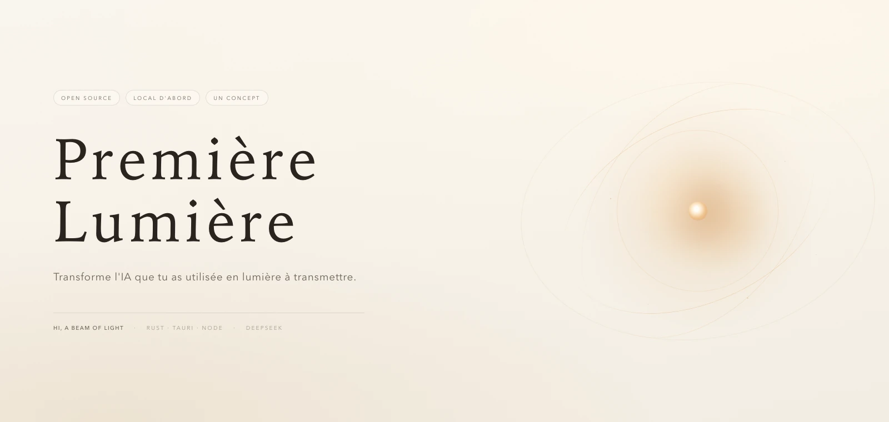
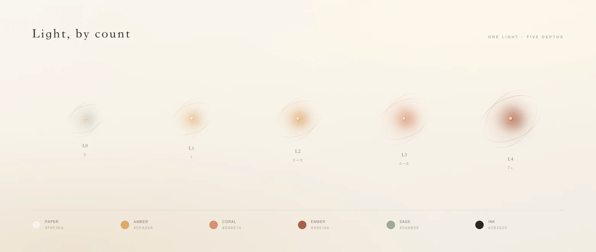
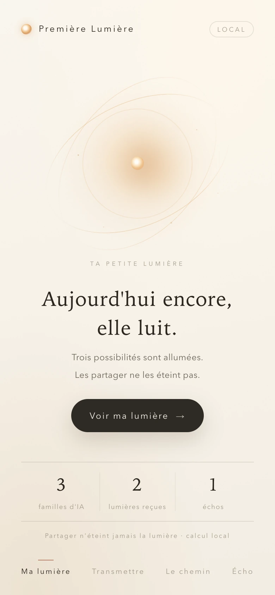
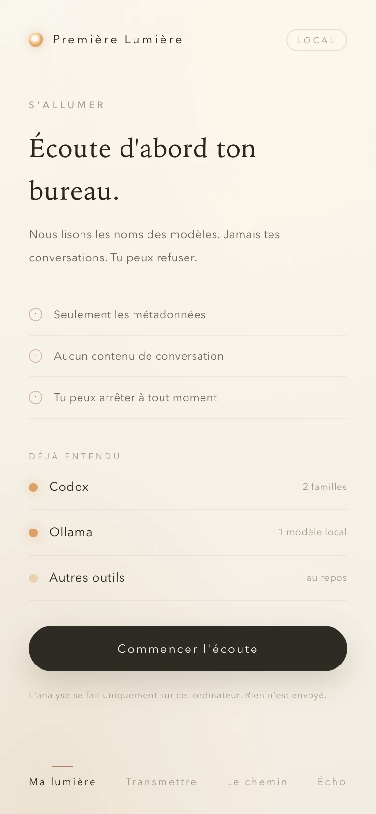
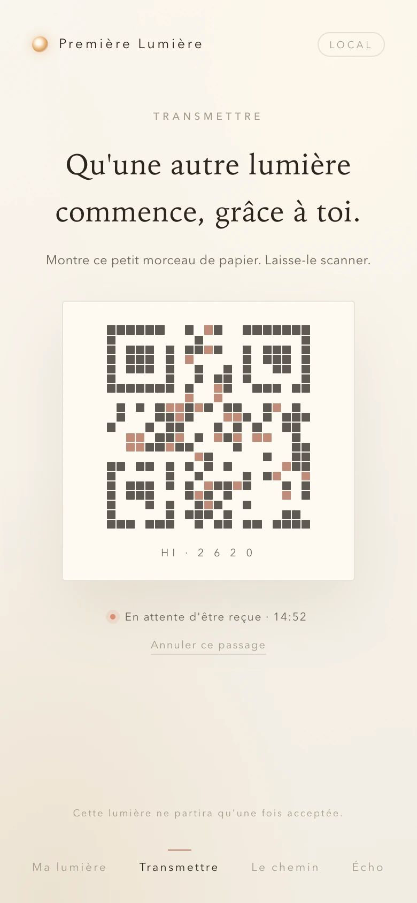
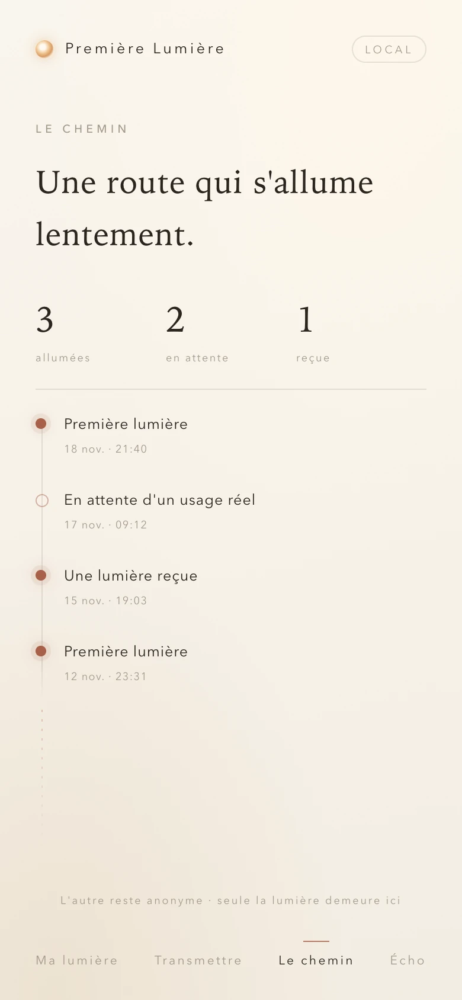
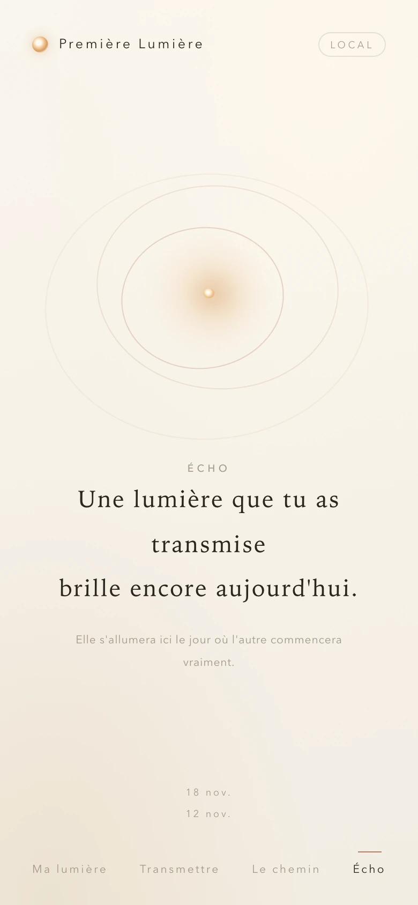
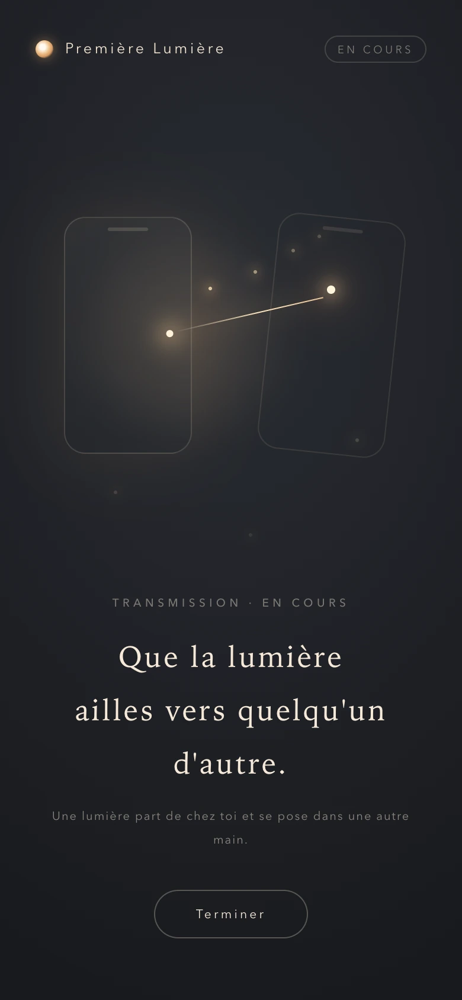

<p align="center">
  
</p>

<p align="center">
  <a href="README.md">中文</a> ·
  <a href="README.en.md">English</a> ·
  <b>Français</b> ·
  <a href="README.ja.md">日本語</a>
</p>

<p align="center">
  
  
  
  
  
</p>

<p align="center">
  <sub>Mots-clés : <code>deepseek</code> · <code>deepseek-harness</code> · <code>local-first</code> · <code>privacy</code> · <code>tauri</code> · <code>rust</code> · <code>healing-ui</code></sub>
</p>

> La lumière ne diminue pas quand on la partage.

---

## Qu’est-ce que c’est

**Première Lumière** est un système-concept de « réseau de transmission de capacités IA » — et une implémentation qui fonctionne.

Il fait trois choses :

1. **S’allumer.** Sur votre propre ordinateur, il ne lit que les métadonnées laissées par les clients d’IA — noms de modèles, existence d’une production réelle dans une session — et transforme « combien de sortes d’IA avez-vous vraiment utilisées » en une seule lumière. Plus les familles vérifiées sont nombreuses, plus la lumière est profonde.
2. **Transmettre.** Passer cette lumière à une autre personne. Ni un compte, ni un quota, ni un parrainage : une invitation qui dit « je commence avec toi ».
3. **L’écho.** C’est seulement quand l’autre commence réellement qu’une lumière apparaît chez vous. Être aidé devient visible pour la première fois.

Il ne classe personne, ne note personne, ne compare pas la valeur des gens. **La lumière représente une capacité, jamais la valeur d’une personne.**

---

## Pourquoi ce projet existe

Tout mesure aujourd’hui qui utilise le plus. Les classements éclairent ceux qui savent déjà et assombrissent ceux qui commencent.

Première Lumière retourne la mesure : **pas à quel point vous avez bien utilisé, seulement que vous avez commencé ; pas qui est en tête, seulement qui transmet.**

- Vous avez utilisé GPT et un modèle Ollama local : deux couches de lumière.
- Vous transmettez la lumière à un ami ; la vôtre ne perd pas une seule couche.
- L’ami commence vraiment ; un écho apparaît ici.

« Une personne commence, d’autres adviennent. » C’est le seul but de ce système.

---

## Comment ça marche



**1. Une écoute locale.**
Uniquement les tables de métadonnées des clients d’IA, et uniquement les colonnes d’une liste blanche. L’analyse se fait sur votre machine ; rien n’est envoyé.
Aucun contenu de conversation, aucun prompt, aucune pièce jointe, aucune capture d’écran.

**2. Normalisation des familles.**
Des valeurs comme `gpt-4o`, `o3`, `codex-mini` sont ramenées à des familles par un dictionnaire versionné.
Mesure : sur 9 valeurs de modèle distinctes, **1 seule était une vraie famille** ; `codex-auto-review` est une étiquette de tâche interne, pas un modèle.
On consulte, on n’infère jamais — un comptage naïf transforme 1 famille en 9.

**3. Deux portes.**
« Un modèle a été nommé » ne suffit pas. Le modèle est écrit à la création de la session ; 78 sessions sur 347 avaient `tokens_used = 0`.
D’où une seconde porte : cette session contenait-elle réellement une production du modèle ?
Mesure : 347 sessions → 140 passent les deux portes → **1 famille**.

**4. Les niveaux de lumière.**
Seules les familles passées par les deux portes approfondissent le cœur.

| Niveau | Familles vérifiées | Aspect de la lumière |
| :-- | :-- | :-- |
| Endormie | 0 | Un grain de poussière argile |
| Naissante | 1 | Un point d’ambre |
| Grandissante | 2–3 | Or chaud, une brume commence |
| Ardente | 4–6 | Corail, un halo plus large |
| Profonde | 7+ | Braise, la couche la plus lourde |

**5. Transmission et écho.**
Initier → l’autre scanne un code ou approche une carte → il accepte → les deux côtés confirment → l’activation s’appuie sur les preuves de **son propre appareil** → un écho vous parvient.
Le serveur ne voit jamais qu’une identité anonyme et un état. Jamais le contenu des conversations, jamais le détail des modèles.

---

## L’interface : une feuille de papier, une lumière

Ce langage visuel s’appelle **Papier chaud, lumière faible** : papier chaud non blanchi, filets de 1px, une lumière qui respire, une phrase qui ne vous presse pas.
Pas de tableau de bord, pas de barre de progression, pas de chiffres transformés en médailles.

<table>
  <tr>
    <td align="center" width="33%"><br><sub><b>Ma lumière</b> · Aujourd’hui encore, elle luit.</sub></td>
    <td align="center" width="33%"><br><sub><b>S’allumer</b> · Écoute d’abord ton bureau.</sub></td>
    <td align="center" width="33%"><br><sub><b>Transmettre</b> · Un petit morceau de papier.</sub></td>
  </tr>
  <tr>
    <td align="center" width="33%"><br><sub><b>Le chemin</b> · Une route qui s’allume lentement.</sub></td>
    <td align="center" width="33%"><br><sub><b>Écho</b> · La page la plus vide.</sub></td>
    <td align="center" width="33%"><br><sub><b>Le passage</b> · Le seul écran nocturne.</sub></td>
  </tr>
</table>

Les images ci-dessus sont des rendus de la maquette dans [`design/healing`](design/healing/), une série par langue ; la version web d’acceptation utilise encore l’interface précédente. Les deux partagent les mêmes niveaux de lumière et les mêmes textes.

Trois règles strictes :

- **La lumière est calme.** Quatre verbes seulement : suinter, respirer, s’étendre, luire. Jamais plus de trois éléments en mouvement sur un écran.
- **Le papier est le fond.** Papier chaud `#F8F3EA` avec 3,5 % de grain ; les séparations sont des filets de 1px à 11 % d’opacité.
- **Le vide est un contenu.** Au moins 40 % d’un écran reste vide. Ce n’est pas inachevé, c’est de la place pour respirer.

Couleurs, paramètres des niveaux, mise en page et mouvement : [`design/healing/README.md`](design/healing/README.md) (en chinois).
Le prototype interactif est [`design/healing/index.html`](design/healing/index.html).

---

## La frontière de la vie privée

C’est la partie la plus sérieuse du projet, et celle qui mérite le plus d’être lue.

**1. La frontière est au niveau de la colonne, pas du fichier.**
Dans un client réel, `threads.model` est une preuve utilisable et `threads.first_user_message` est la parole de l’utilisateur — **dans le même fichier, la même table.**
« Nous ne lisons pas les conversations » n’est donc pas une promesse. C’est une liste blanche de colonnes, une liste noire globale, un chemin d’accès unique et un audit à l’exécution.

**2. En lecture seule, sans déranger.**
Les bases sont ouvertes avec `SQLITE_OPEN_READ_ONLY` et `immutable=1` : aucun verrou, aucune écriture, aucune gêne.

**3. L’auto-déclaration ne compte pas.**
Vous pouvez cocher « j’ai utilisé Claude ». C’est enregistré en E2 seulement : cela n’approfondit jamais le cœur, n’élève jamais le titre.

**4. Les données restent chez vous.**
Calcul local, stockage local (SQLite), clé dans le trousseau du système. Le seul trafic réseau est l’invitation elle-même, avec une identité anonyme et un état.

> Audit complet : `docs/security/`, `docs/reports/privacy-audit.md`, `docs/reports/f2-privacy-audit.md`.
> 21 tests négatifs sont consignés dans les rapports d’acceptation.

---

## Architecture

```
┌──────────────────────────────────────────────────────────────┐
│ Clients                                                       │
│  Bureau, Tauri 2 (macOS)   Aperçu web   Mini-programme WeChat  │
└───────────────┬──────────────────┬───────────────────────────┘
                │                  │
┌───────────────▼──────────────────▼───────────────────────────┐
│ Noyau Rust (sans I/O)                                         │
│   light-core    identité / registre / preuves / niveau / FSM  │
│   adapter-sdk   liste blanche de colonnes + liste noire       │
│   adapter-codex preuves à deux portes (mesurées)              │
│   adapter-ollama preuves des modèles locaux                   │
│   light-store   SQLite local (hors ligne, schéma v1)          │
└───────────────┬──────────────────────────────────────────────┘
                │ signatures Ed25519 / HTTPS
┌───────────────▼──────────────────────────────────────────────┐
│ Serveur : Node 24 + Hono + PostgreSQL (PGlite en test)        │
│   invitation / confirmation mutuelle / activation / écho      │
└──────────────────────────────────────────────────────────────┘
```

| Chemin | Contenu |
| :-- | :-- |
| `crates/light-core` | Noyau pur : identité, registre, preuves, niveaux, titres, machine à états, protocole (sans I/O) |
| `crates/adapter-sdk` | Accès contrôlé au niveau des colonnes + liste noire globale |
| `crates/adapter-codex`, `adapter-ollama` | Les deux adaptateurs réels |
| `crates/light-store` | Stockage SQLite local et migrations |
| `apps/desktop` | Bureau Tauri : lumière flottante transparente + panneau à quatre écrans |
| `apps/browser-preview` | Version web d’acceptation : ouverture, accueil, transmission, carte réelle, annotations privées |
| `apps/wechat-miniprogram` | Source native du mini-programme WeChat |
| `services/api` | Serveur de transmission : invitation, confirmation, activation, écho |
| `packages/protocol` | 11 schémas JSON + fixtures partagées + une implémentation TypeScript indépendante |
| `data/model-registry.v1.json` | Dictionnaire versionné des familles (donnée, pas code) |
| `docs/adr` | 12 décisions d’architecture, chacune nommant ce qu’elle a rejeté |
| `design/healing` | Cette interface apaisante : prototype, mouvement, scripts de rendu |

Les dépendances vont dans un seul sens : `light-core` ne dépend de rien d’autre ; un adaptateur ne dépend jamais de la logique serveur.

---

## Où en est le projet

Ce dépôt ne veut pas offrir « c’est terminé », mais **une honnêteté vérifiable**. Chaque statut a une commande et une sortie dans `docs/reports/`.

| Capacité | État |
| :-- | :-- |
| Normalisation des familles | Testé |
| Niveaux de preuve E0–E4 + deux portes | Testé (mesuré sur données réelles) |
| Frontière de vie privée au niveau colonne | Testé (21 tests négatifs) |
| Identité anonyme, rotation de clé, code de récupération | Testé |
| Niveaux / deux échelles de titres / parité du protocole | Testé (Rust ↔ TypeScript) |
| Machine à états de transmission et serveur | Testé (T1–T15) |
| Lumière transparente du bureau (macOS) | Vérifié (preuves au pixel) |
| Boucle de transmission entre deux instances | Intégré |
| Version web d’acceptation (ouverture / transmission / carte) | Implémentée, exécutable en local |
| Mini-programme WeChat | Source synchronisée, non vérifiée sur appareil |
| Windows / iOS / Android | Non fait |
| Matériel NFC, déploiement public | Non fait (ni matériel, ni domaine) |

Tests : **229 tests automatisés** (188 Rust + 12 protocole + 29 serveur) + **14 tests de bout en bout** côté bureau.
Voir `docs/reports/test-execution.md`. Les chiffres sont un relevé, pas une promesse ; relancez-les chez vous.

---

## Démarrage rapide

```bash
# 1. Juste l’interface (Python 3, aucune dépendance front-end)
python3 tools/launch/launch_preview.py     # http://127.0.0.1:8897

# 2. Noyau Rust (sans réseau ni base de données)
cargo test

# 3. Parité du protocole entre langages
cd packages/protocol && node --test test/conformance.test.mjs

# 4. Serveur de transmission
cd services/api && node --test test/*.test.mjs
```

La version web est une simulation : on peut cliquer le scan et la transmission, mais elle ne lit jamais votre ordinateur.
L’application de bureau réelle se compile avec Tauri ; le comportement de sa fenêtre a été vérifié sur macOS.

---

## Par où commencer la lecture

| Vous cherchez | Lisez |
| :-- | :-- |
| Le jugement produit et les trois conclusions | « Comment ça marche » ci-dessus, puis `docs/01-architecture.md` |
| Pourquoi la frontière est tracée ainsi | `docs/adr/ADR-001`, `ADR-011` |
| Les interfaces de chaque crate | `docs/module-interfaces.md` |
| Les mesures sur données réelles | `docs/reports/evidence-report.md`, `f2-codex-integration.md` |
| L’audit de vie privée | `docs/reports/privacy-audit.md` |
| La performance (0,031 % de CPU au repos) | `docs/reports/f2-performance.md`, `f35-performance.md` |
| Le design de l’interface | `design/healing/README.md`, `docs/visual-system-v2.md` |

---

## Construit avec DeepSeek

Ce dépôt — du concept et de l’interface à l’implémentation Rust / TypeScript et à la documentation — a été construit en collaboration avec **DeepSeek Harness (`deepseek-flash`)**.
Le jugement produit, les arbitrages de vie privée et l’acceptation finale restent ceux de l’auteur.

Si vous venez de la communauté DeepSeek, voici où le trouver :

`deepseek` · `deepseek-chat` · `deepseek-coder` · `deepseek-harness` · `dsh` · `built-with-deepseek`
· `local-first` · `privacy-first` · `tauri` · `rust` · `wechat-miniprogram` · `healing-ui` · `concept`

Les topics GitHub portent ces mots-clés : la recherche et l’abonnement le trouveront.

[](https://github.com/deepseek-ai/deepseek-harness)

---

## Contribuer

- Une idée : ouvrez une issue et racontez le moment où vous auriez aimé être éclairé.
- Un adaptateur : lisez d’abord `docs/adr/ADR-001`. La liste blanche de colonnes est une condition de fusion, pas une suggestion.
- L’interface : modifiez le CSS dans `design/healing/`, puis lancez `node render.mjs && python3 optimize.py`.

**Licence** : MIT. Prenez-le, modifiez-le, utilisez-le commercialement — gardez la mention de copyright.

Les quatre README et leurs images d’interface sont complets et séparés, sans mélange.

<p align="center"><sub>La lumière ne diminue pas quand on la partage. · Une personne commence, d’autres adviennent.</sub></p>
