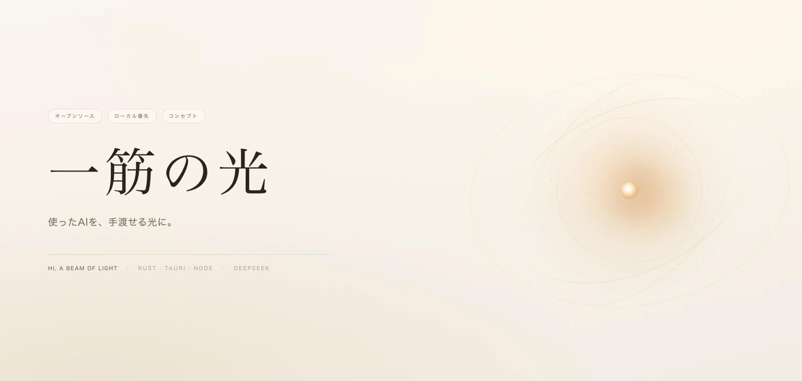
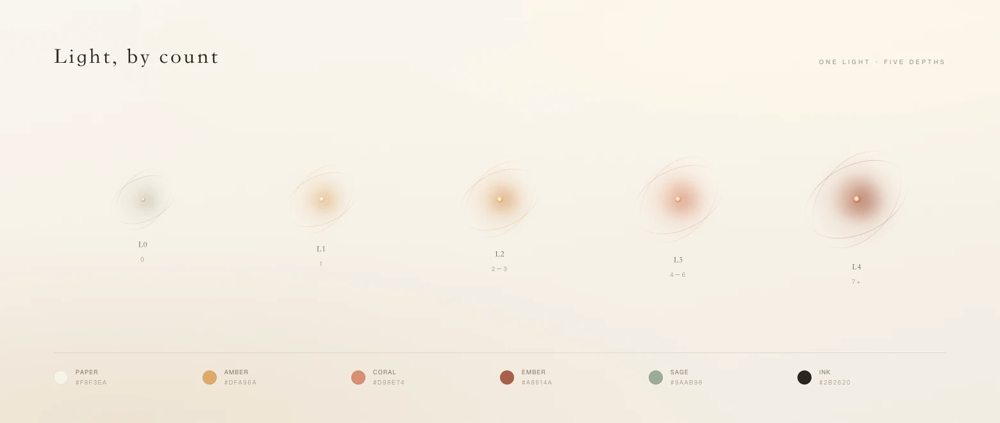
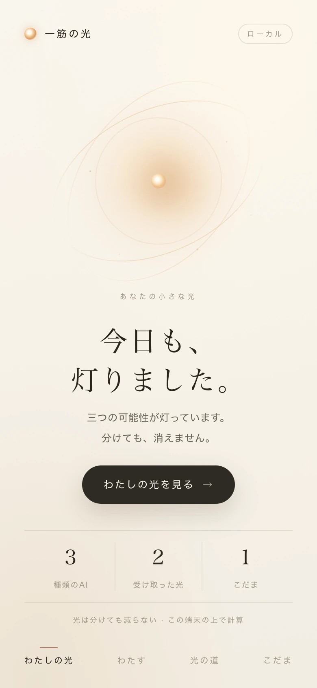
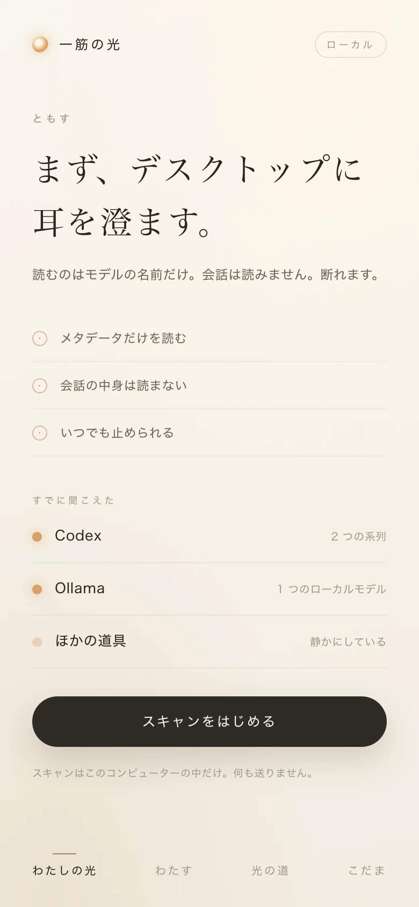
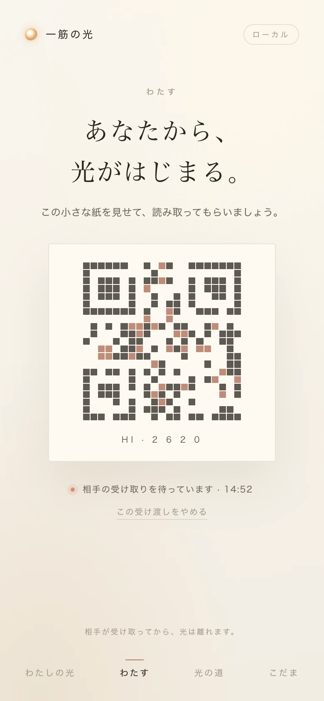
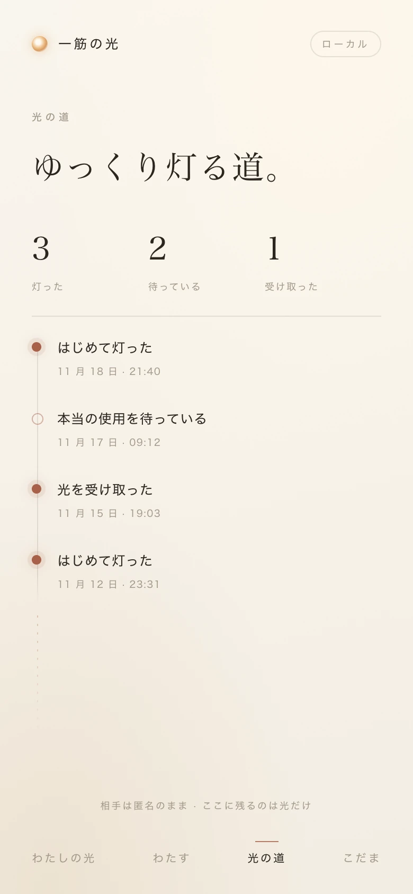
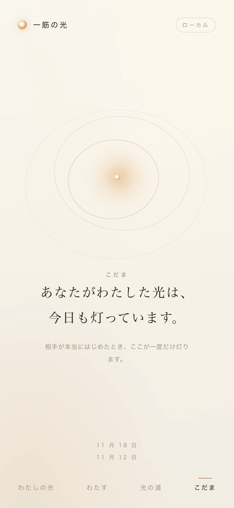
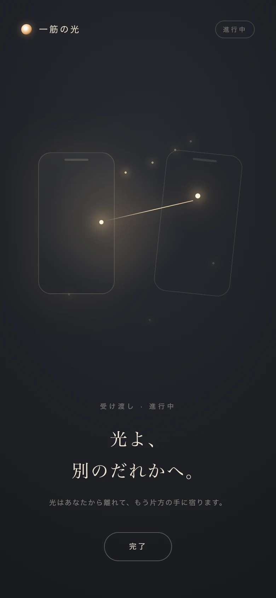

<p align="center">
  
</p>

<h1 align="center">一筋の光</h1>

<p align="center">
  <em>使ったAIを、手渡せる光に。</em>
</p>

<p align="center">
  <a href="README.md">中文</a> ·
  <a href="README.en.md">English</a> ·
  <a href="README.fr.md">Français</a> ·
  <b>日本語</b>
</p>

<p align="center">
  
  
  
  
  
</p>

<p align="center">
  <sub>タグ：<code>deepseek</code> · <code>deepseek-harness</code> · <code>local-first</code> · <code>privacy</code> · <code>tauri</code> · <code>rust</code> · <code>healing-ui</code></sub>
</p>

> 光は分けても減らない。

---

## これは何か

**一筋の光**は「AI 能力の伝達ネットワーク」というコンセプトシステムであり、同時に動く実装です。

やることは三つです。

1. **ともす** —— 自分のコンピューターの上で、AI クライアントが残したメタデータ（モデル名、そのセッションに実際の出力があったか）だけを読み、「本当に何種類の AI を使ってきたか」を一筋の光に変えます。確認できた系列が多いほど、光は深くなります。
2. **わたす** —— その光を別の人へ手渡します。アカウントでも、利用枠でも、紹介でもありません。「わたしも一緒にはじめる」という招待です。
3. **こだま** —— 相手が本当にはじめたときだけ、こちらに光が灯ります。助けられたという事実が、はじめて見えるようになります。

人を順位づけません。点数をつけません。人の価値を比べません。**光は能力のしるしであって、人の価値の評価ではありません。**

---

## なぜ必要か

いまは「誰がより多く使ったか」ばかりが数えられています。ランキングは、すでに分かっている人を明るくし、これから始める人を暗くします。

一筋の光は、数え方を逆にします。**どれだけ上手に使ったかではなく、はじめたこと。先にいる人ではなく、手渡した人を。**

- GPT も、ローカルの Ollama も使った —— 光は二層になります。
- 友だちに光をわたしても、自分の光はひとつも減りません。
- 友だちが本当にはじめたとき、こちらに一度だけこだまが届きます。

「ひとりがはじめて、もっと多くの人に起こる。」それがこのシステムの唯一の目的です。

---

## 仕組み



**1. ローカルで聴く。**
AI クライアントのメタデータ表だけを、許可された列だけ読みます。スキャンはあなたの機械の上で完結し、どこにも送られません。
会話の中身、プロンプト、添付ファイル、スクリーンショットは読みません。

**2. 系列の正規化。**
`gpt-4o`、`o3`、`codex-mini` といった値を、版管理された辞書で「系列」にまとめます。
実測：9 種類の異なるモデル値のうち、本当の系列は **1 つだけ**でした。`codex-auto-review` は内部のタスク名で、モデルではありません。
辞書を引くだけで、推測はしません —— 素朴に数えると 1 系列が 9 系列になります。

**3. 二つのゲート。**
「モデル名が書かれている」だけでは足りません。モデル名はセッション作成時に書かれ、347 セッションのうち 78 は `tokens_used = 0` でした。
そこで二つ目のゲート：そのセッションにモデルの出力が実在したか。
実測：347 セッション → 140 が二つのゲートを通過 → **1 系列**。

**4. 光の段階。**
二つのゲートを通った系列だけが光核を深くします。

| 段階 | 確認できた系列 | 光のようす |
| :-- | :-- | :-- |
| 眠り | 0 | 陶土色の小さな塵 |
| ほのか | 1 | 琥珀の一点 |
| 育ち | 2–3 | 暖かい金、霧が生まれる |
| 燃え | 4–6 | 珊瑚色、光暈が広がる |
| 深紅 | 7+ | 残り火、いちばん重い層 |

**5. 受け渡しとこだま。**
開始 → 相手がコードを読む、またはカードに触れる → 相手が自分で受け取る → 両側が確認 → **相手自身の端末**の証拠で有効化 → こちらに一度のこだま。
サーバーが見るのは匿名の身元と状態だけです。会話の中身も、モデルの詳細も見えません。

---

## 画面：一枚の紙、一筋の光

このデザイン言語を **暖かい紙、ほのかな光** と呼びます。漂白していない暖かい紙、1px の細い線、呼吸する一筋の光、急かさない一言。
ダッシュボードも、進捗バーも、数字をメダルにすることもしません。

<table>
  <tr>
    <td align="center" width="33%"><br><sub><b>わたしの光</b> · 今日も、灯りました。</sub></td>
    <td align="center" width="33%"><br><sub><b>ともす</b> · まず、デスクトップに耳を澄ます。</sub></td>
    <td align="center" width="33%"><br><sub><b>わたす</b> · 小さな紙を一枚。</sub></td>
  </tr>
  <tr>
    <td align="center" width="33%"><br><sub><b>光の道</b> · ゆっくり灯る道。</sub></td>
    <td align="center" width="33%"><br><sub><b>こだま</b> · いちばん空のページ。</sub></td>
    <td align="center" width="33%"><br><sub><b>受け渡し</b> · 唯一の夜色。</sub></td>
  </tr>
</table>

三つの固い決まり：

- **光は静か。** 動きは四つだけ —— 滲む、呼吸する、広がる、灯る。ひとつの画面で同時に動く要素は三つまで。
- **紙が下地。** 暖かい紙 `#F8F3EA` に 3.5% の粒子。区切りは 1px、透明度 11% の線だけ。
- **余白は内容。** 画面の 40% 以上は空けます。未完成ではなく、息をするための場所です。

色、光の段階の数値、組版、動きの規則は [`design/healing/README.md`](design/healing/README.md)（中国語）にあります。
操作できる原型は [`design/healing/index.html`](design/healing/index.html) です。

---

## プライバシーの境界

このプロジェクトでいちばん真剣な部分であり、いちばん読む価値のある部分です。

**1. 境界はファイル単位ではなく、列単位。**
実際のクライアントでは、`threads.model` は使える証拠で、`threads.first_user_message` はユーザーの言葉です —— **同じファイル、同じ表の中に**あります。
だから「会話は読みません」は約束ではなく、列の許可リスト、全体の禁止リスト、唯一の読み取り経路、実行時の監査として実装されています。

**2. 読み取り専用で、邪魔をしない。**
`SQLITE_OPEN_READ_ONLY` と `immutable=1` で開きます。ロックも書き込みもせず、相手のアプリを妨げません。

**3. 自己申告は数えない。**
「Claude を使った」と手で選んでも、E2 として記録されるだけです。光核は深くならず、称号も上がりません。

**4. データは外に出ない。**
計算も保存もこの端末（SQLite）、鍵は OS のキーチェーン。ネットワークに出るのは受け渡しの招待だけで、そこに載るのは匿名の身元と状態だけです。

> 監査の全文：`docs/security/`、`docs/reports/privacy-audit.md`、`docs/reports/f2-privacy-audit.md`。
> 21 項目の負のテストが受入報告に記録されています。

---

## アーキテクチャ

```
┌──────────────────────────────────────────────────────────────┐
│ クライアント                                                  │
│  デスクトップ Tauri 2 (macOS)  ブラウザ版  WeChat ミニプログラム │
└───────────────┬──────────────────┬───────────────────────────┘
                │                  │
┌───────────────▼──────────────────▼───────────────────────────┐
│ Rust コア（I/O なし）                                          │
│   light-core    身元 / 辞書 / 証拠 / 段階 / 称号 / 状態機械      │
│   adapter-sdk   列の許可リスト + 禁止リスト + 唯一の読み取り経路 │
│   adapter-codex 二つのゲートによる証拠判定（実データで実測）     │
│   adapter-ollama ローカルモデルの証拠                          │
│   light-store   ローカル SQLite（オフライン、schema v1）        │
└───────────────┬──────────────────────────────────────────────┘
                │ Ed25519 署名 / HTTPS
┌───────────────▼──────────────────────────────────────────────┐
│ サーバー：Node 24 + Hono + PostgreSQL（テストは PGlite）        │
│   招待 / 双方確認 / 有効化 / こだま                             │
└──────────────────────────────────────────────────────────────┘
```

| 場所 | 内容 |
| :-- | :-- |
| `crates/light-core` | 純粋なコア：身元、辞書、証拠、段階、称号、状態機械、プロトコル（I/O なし） |
| `crates/adapter-sdk` | 列単位の統制されたアクセス + 全体の禁止リスト |
| `crates/adapter-codex`、`adapter-ollama` | 二つの実アダプター |
| `crates/light-store` | ローカル SQLite の保存と移行 |
| `apps/desktop` | Tauri デスクトップ：透明で最前面の光 + 四画面パネル |
| `apps/browser-preview` | ブラウザ受入版：開幕、ホーム、受け渡し、実地図、私的な注釈 |
| `apps/wechat-miniprogram` | WeChat ミニプログラムのネイティブソース |
| `services/api` | 受け渡しサーバー：招待、確認、有効化、こだま |
| `packages/protocol` | 11 の JSON Schema + 共有フィクスチャ + 独立した TypeScript 実装 |
| `data/model-registry.v1.json` | 版管理された系列辞書（データであってコードではない） |
| `docs/adr` | 12 の設計判断記録。それぞれが「何を捨てたか」を書いています |
| `design/healing` | この界面：原型、動き、書き出しスクリプト |

依存の向きは一方向です。`light-core` は他の何にも依存せず、アダプターがサーバーの論理に依存することはありません。

---

## いまどこまで来ているか

このリポジトリが渡したいのは「完成」ではなく、**確かめられる正直さ**です。どの状態にも `docs/reports/` のコマンドと出力があります。

| 能力 | 状態 |
| :-- | :-- |
| モデル系列の正規化 | テスト済み |
| E0–E4 の証拠段階 + 二つのゲート | テスト済み（実データで実測） |
| 列単位のプライバシー境界 | テスト済み（21 項目の負のテスト） |
| 匿名の身元、鍵の更新、回復コード | テスト済み |
| 光の段階 / 二つの称号 / プロトコルの一致 | テスト済み（Rust ↔ TypeScript 双方向） |
| 受け渡しの状態機械とサーバー | テスト済み（T1–T15） |
| デスクトップの透明な光（macOS） | 検証済み（画素レベルの証拠） |
| 二つの実体による受け渡しの閉環 | 結合済み |
| ブラウザ受入版（開幕 / 受け渡し / 地図） | 実装済み、ローカルで動作 |
| WeChat ミニプログラム | ソース同期済み、実機未検証 |
| Windows / iOS / Android | 未完了 |
| NFC 実機、公開デプロイ | 未完了（ハードウェアとドメインがない） |

テスト記録：**229 項目の自動テスト**（Rust 188 + プロトコル 12 + サーバー 29）+ **デスクトップの端末間テスト 14 項目**。
詳細は `docs/reports/test-execution.md`。数字は記録であって約束ではありません。あなたの機械で再実行してください。

---

## はじめかた

```bash
# 1. 界面だけ見る（Python 3。フロントエンドの導入は不要）
python3 tools/launch/launch_preview.py     # http://127.0.0.1:8897

# 2. Rust コア（ネットワークもデータベースも不要）
cargo test

# 3. 言語をまたぐプロトコルの一致
cd packages/protocol && node --test test/conformance.test.mjs

# 4. 受け渡しサーバー
cd services/api && node --test test/*.test.mjs
```

ブラウザ版は模擬体験です。スキャンも受け渡しも押せますが、あなたのコンピューターは読みません。
実際のデスクトップ版は Tauri でビルドし、窓の性質は macOS で検証済みです。

---

## どこから読むか

| 知りたいこと | 読む場所 |
| :-- | :-- |
| 製品の判断と三つの結論 | 上の「仕組み」と `docs/01-architecture.md` |
| なぜこの境界の切り方なのか | `docs/adr/ADR-001`、`ADR-011` |
| 各 crate のインターフェース | `docs/module-interfaces.md` |
| 実データでの実測 | `docs/reports/evidence-report.md`、`f2-codex-integration.md` |
| プライバシー監査 | `docs/reports/privacy-audit.md` |
| 性能（アイドル時 CPU 0.031%） | `docs/reports/f2-performance.md`、`f35-performance.md` |
| 界面の設計 | `design/healing/README.md`、`docs/visual-system-v2.md` |

---

## DeepSeek で構築

このリポジトリは、コンセプトから界面、Rust / TypeScript の実装、文書にいたるまで、**DeepSeek Harness（`deepseek-flash`）** との協働で作られました。
製品の判断、プライバシーの取舍、最終的な受入は作者にあります。

DeepSeek コミュニティから来た方へ。探すときの手がかりはこちらです。

`deepseek` · `deepseek-chat` · `deepseek-coder` · `deepseek-harness` · `dsh` · `built-with-deepseek`
· `local-first` · `privacy-first` · `tauri` · `rust` · `wechat-miniprogram` · `healing-ui` · `concept`

GitHub の topics にこれらの語を入れてあるので、検索と購読で見つかります。

---

## 参加する

- 新しい考え：issue を開いて、「どんな場面で灯ってほしかったか」を書いてください。
- アダプターを足す：まず `docs/adr/ADR-001` を読んでください。列の許可リストは統合の条件であって、提案ではありません。
- 界面を変える：`design/healing/` の CSS を直し、`node render.mjs && python3 optimize.py` を実行してください。

**ライセンス**：MIT。持ち帰って、変えて、商用利用もできます。著作権表示だけ残してください。

四つの言語の README と画面画像は、それぞれ独立して完結し、混ざっていません。

<p align="center"><sub>光は分けても減らない。 · ひとりがはじめて、もっと多くの人に起こる。</sub></p>
