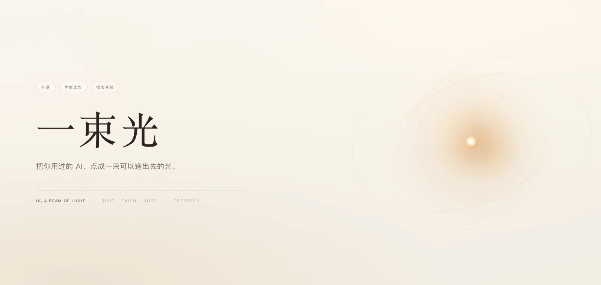
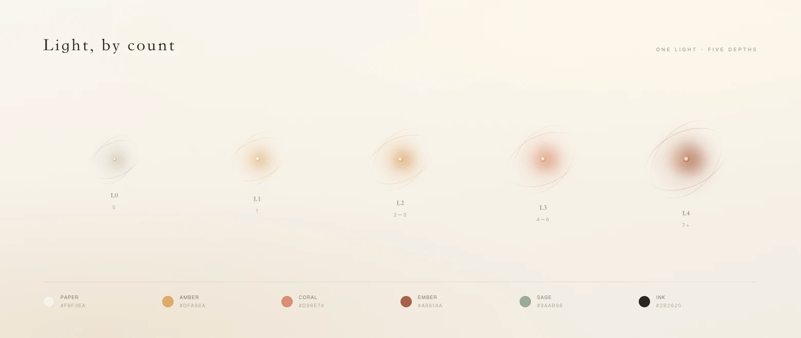
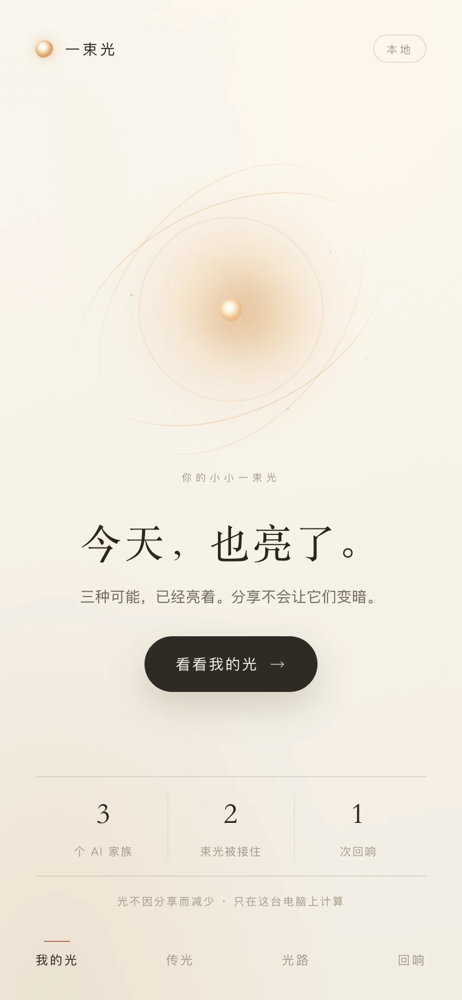
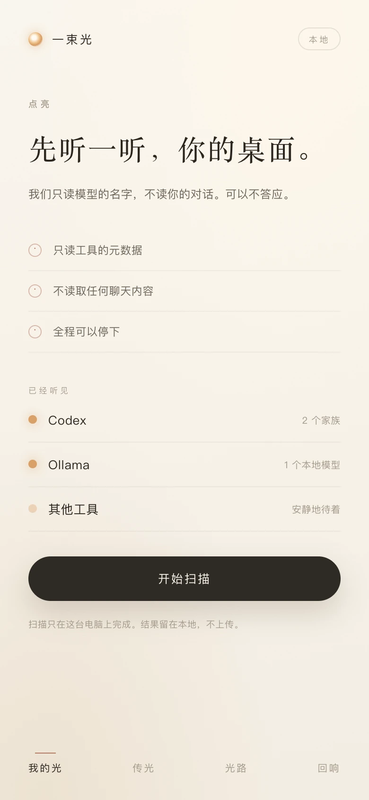
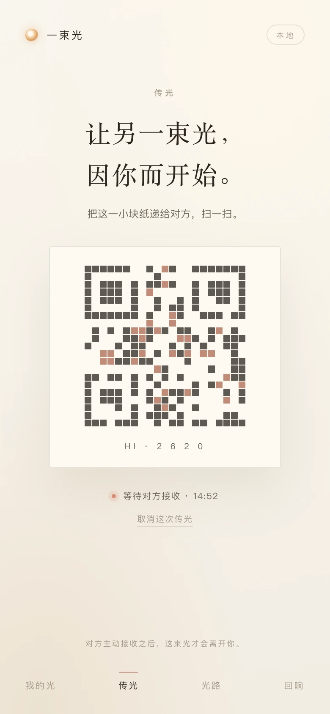
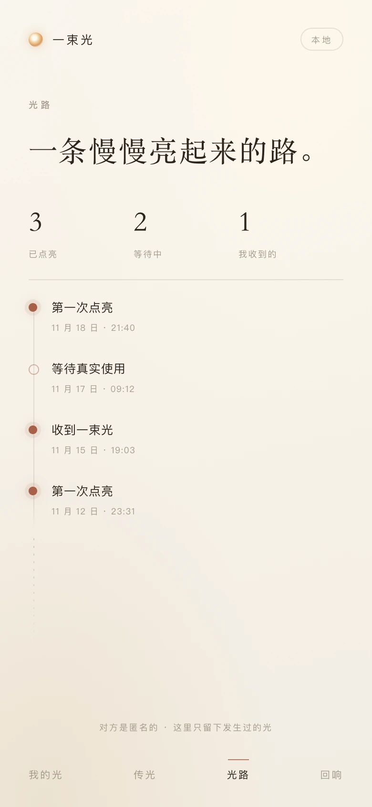
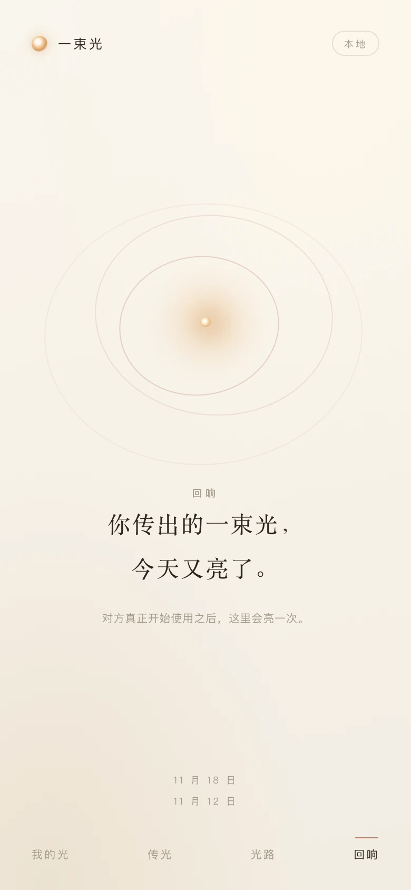
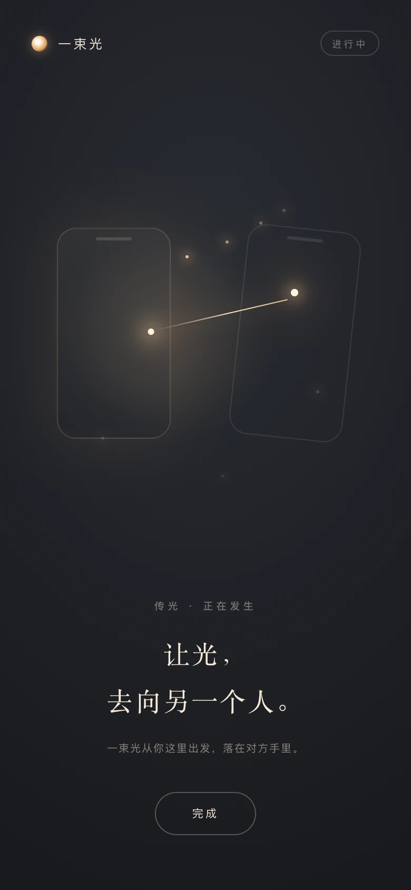

<p align="center">
  
</p>

<p align="center">
  <b>中文</b> ·
  <a href="README.en.md">English</a> ·
  <a href="README.fr.md">Français</a> ·
  <a href="README.ja.md">日本語</a>
</p>

<p align="center">
  
  
  
  
  
</p>

<p align="center">
  <sub>标签：<code>deepseek</code> · <code>deepseek-harness</code> · <code>local-first</code> · <code>privacy</code> · <code>tauri</code> · <code>rust</code> · <code>healing-ui</code></sub>
</p>

> 光不因分享而减少。

---

## 这是什么

**一束光**是一个关于「AI 怎么传下去」的系统，也是一份可以跑起来的实现。

它只相信一件事：**AI 不会自己普及，得有人教。**

它做三件事：

1. **点亮** —— 在你自己的电脑上，只读取 AI 客户端留下的元数据（模型名、会话是否有产出），把「你真的用过几种 AI」变成一束光。用过的家族越多，光越深。
2. **传光** —— 把这束光传给另一个人。不是传账号、不是传额度、不是拉新，而是坐下来，陪一个还没开始的人用起第一个 AI 工具。
3. **回响** —— 对方真的开始使用之后，你这里才会亮一次。被帮助过这件事，第一次变得可见。

它不排名、不打分、不比较人的价值。**光是能力的象征，不是人的价值评分。**

---

## 为什么要有它

今天所有人都在统计「谁用得更多」。排行榜让已经会的人更亮，让刚开始的人更暗。

一束光把统计反过来用：**不统计你用得多好，只确认你已经开始；不奖励领先，只奖励一件事——把别人教会。**

- 你用过 GPT，也用过本地 Ollama —— 光是两层。
- 你把光传给朋友，你的光不会因此少一格。
- 朋友第一次真正用起来，你这里才会出现一次回响。

「AI 大家都要用起来；一个人先开始，更多人发生。」这是这个系统唯一的目标。

---

## 传播是怎么发生的

不是拉新、不是发账号、不是丢一个教程链接——是一对一的教。

1. **一个人先开始。** 你自己用起 AI，桌面上的光点亮。
2. **他教给另一个人。** 不是把账号密码递过去，而是坐下来，陪对方完成第一次真正的使用。
3. **那个人自己用起来。** 光靠他自己的证据点亮——扫码不会亮，下载不会亮，真的用了才亮。
4. **他再去教下一个人。** 一传二，二传四。所谓燎原，不是火烧得大，而是每一颗火星都能点着下一颗。

---

## 它怎么工作



**第一步 · 本地扫描。**
只读 AI 客户端的元数据表，且只读白名单里的列。扫描在你的机器上完成，结果不上传。
不读聊天正文、不读提示词、不读附件、不截图。

**第二步 · 家族归一。**
把 `gpt-4o`、`o3`、`codex-mini` 这样的取值，按版本化字典归到「家族」。
实测：9 个不同的模型取值里，只有 **1 个真实家族**；`codex-auto-review` 是内部任务标签，不是模型。
只查表，绝不推断——朴素计数会把 1 个家族算成 9 个。

**第三步 · 双闸门。**
「用了哪个模型」不够。模型名在会话创建时就写入了，347 个会话里有 78 个 `tokens_used = 0`。
所以还要第二个闸门：这个会话里是否真的存在模型产出物。
实测：347 个会话 → 140 个通过双闸门 → **1 个家族**。

**第四步 · 光阶。**
只有通过双闸门的家族才点亮光核。

| 光阶 | 可信家族数 | 光的样子 |
| :-- | :-- | :-- |
| 沉睡 | 0 | 灰陶色的微尘 |
| 微明 | 1 | 一点琥珀 |
| 生长 | 2–3 | 暖金，开始有雾 |
| 炽热 | 4–6 | 珊瑚色，光晕变宽 |
| 深红 | 7+ | 余烬色，最沉的一层 |

**第五步 · 传光与回响。**
发起 → 对方扫码或碰卡 → 对方主动接收 → 双方确认 → 用**对方本机**的证据激活 → 你收到一次回响。
整个过程里，服务端只见到匿名身份与状态，见不到聊天内容，也见不到模型明细。

---

## 界面：一页纸，一束光

这一版的界面语言叫**温纸微光**：未漂白的暖纸、1px 的淡线、一束会呼吸的光、一句不催促的话。
不做仪表盘，不做进度条，不把数字做成奖章。

<table>
  <tr>
    <td align="center" width="33%"><br><sub><b>我的光</b> · 今天，也亮了。</sub></td>
    <td align="center" width="33%"><br><sub><b>点亮</b> · 先听一听，你的桌面。</sub></td>
    <td align="center" width="33%"><br><sub><b>传光</b> · 一块纸作票根。</sub></td>
  </tr>
  <tr>
    <td align="center" width="33%"><br><sub><b>光路</b> · 一条慢慢亮起来的路。</sub></td>
    <td align="center" width="33%"><br><sub><b>回响</b> · 最空的一页。</sub></td>
    <td align="center" width="33%"><br><sub><b>传光时刻</b> · 唯一的一屏夜色。</sub></td>
  </tr>
</table>

以上为 [`design/healing`](design/healing/) 的界面设计稿渲染，四种语言各有一套；浏览器验收版仍是早期界面，二者共用同一套光阶与文案。

设计上有三条硬规则：

- **光是安静的**：只有四种动作——渗、呼、散、亮。任何一屏同时动的元素不超过三个。
- **纸是底色**：暖纸 `#F8F3EA` 加 3.5% 噪点，分隔只用 1px、11% 透明度的线。
- **留白是内容**：一屏至少 40% 是空的。空的不是没做完，是留给你呼吸。

完整的色彩、光阶参数、版式与动效规则见 [`design/healing/README.md`](design/healing/README.md)；
设计原型可以直接打开 [`design/healing/index.html`](design/healing/index.html)。

---

## 隐私边界

这是整个项目最较真的地方，也是最值得看的部分。

**1. 边界是列级的，不是文件级的。**
实测真实客户端：`threads.model` 是可用的证据，而 `threads.first_user_message` 是用户原话——**它们在同一个文件、同一张表里**。
所以「不读聊天正文」不是一句承诺，而是一条列级 allowlist + 全局禁读清单 + 唯一数据访问路径 + 运行时审计。

**2. 只读，不打扰。**
以 `SQLITE_OPEN_READ_ONLY` + `immutable=1` 打开他方数据库，不锁、不写回、不影响对方应用。

**3. 自我声称不算数。**
你可以手动勾选「我用过 Claude」，但它只记为 E2，不加深光核、不提升称号。

**4. 数据不出门。**
本机计算、本机存储（SQLite）、私钥进系统钥匙串。唯一的网络行为是传光邀请本身，且只带匿名身份与状态。

> 详细审计：`docs/security/`、`docs/reports/privacy-audit.md`、`docs/reports/f2-privacy-audit.md`。
> 21 项负向测试记录在验收报告中。

---

## 架构

```
┌──────────────────────────────────────────────────────────────┐
│ 客户端                                                        │
│  桌面 Tauri 2 (macOS)      浏览器验收版      微信小程序（原生） │
└───────────────┬──────────────────┬───────────────────────────┘
                │                  │
┌───────────────▼──────────────────▼───────────────────────────┐
│ Rust 核心（无 I/O）                                           │
│   light-core    身份 / 注册表 / 证据 / 光阶 / 称号 / 状态机     │
│   adapter-sdk   列级 allowlist + 全局禁读清单 + 唯一读路径      │
│   adapter-codex 双闸门证据判定（真实数据实测）                  │
│   adapter-ollama 本地模型证据                                  │
│   light-store   本地 SQLite（离线自足，schema v1 + 迁移）       │
└───────────────┬──────────────────────────────────────────────┘
                │ Ed25519 签名 / HTTPS
┌───────────────▼──────────────────────────────────────────────┐
│ 服务端 Node 24 + Hono + PostgreSQL（测试用 PGlite）             │
│   邀请 / 双方确认 / 激活 / 回响；状态机；反重放；限流            │
└──────────────────────────────────────────────────────────────┘
```

| 目录 | 内容 |
| :-- | :-- |
| `crates/light-core` | 纯核心：身份、注册表、证据、光阶、称号、状态机、协议（无 I/O） |
| `crates/adapter-sdk` | 列级受控数据访问层 + 全局禁读清单 |
| `crates/adapter-codex`、`adapter-ollama` | 两个真实适配器 |
| `crates/light-store` | 本地 SQLite 存储与迁移 |
| `apps/desktop` | Tauri 桌面端：透明置顶光点 + 四屏面板 |
| `apps/browser-preview` | 浏览器验收版：开场、首页、传光、真实地图、私人标注 |
| `apps/wechat-miniprogram` | 原生微信小程序源码 |
| `services/api` | 传光服务端：邀请、确认、激活、回响 |
| `packages/protocol` | 11 个 JSON Schema + 共享夹具 + TypeScript 独立参考实现 |
| `data/model-registry.v1.json` | 版本化模型家族字典（数据，不是代码） |
| `docs/adr` | 12 份架构决策记录，每一条都写了「否决了什么」 |
| `design/healing` | 这一版疗愈界面：原型、动效、出图脚本 |

依赖方向严格单向：`light-core` 不依赖任何其他 crate；适配器不得反向依赖服务端逻辑。

---

## 今天到哪里了

这个仓库最想给你的，不是「已完成」，而是**可核对的诚实**。每条状态都能在 `docs/reports/` 里找到命令与输出。

| 能力 | 状态 |
| :-- | :-- |
| 模型家族归一化 | 已测试 |
| E0–E4 证据分级 + 双闸门 | 已测试（真实数据实测） |
| 列级隐私边界 | 已测试（21 项负向测试） |
| 匿名身份、密钥轮换、恢复码 | 已测试 |
| 光阶 / 双称号 / 协议一致性 | 已测试（Rust ↔ TypeScript 双向） |
| 传光状态机与服务端 | 已测试（T1–T15） |
| 桌面透明光点（macOS） | 已验收（像素级证据） |
| 桌面双实例传光闭环 | 已联调 |
| 浏览器验收版（开场 / 传光 / 地图） | 已实现，可本地运行 |
| 微信小程序 | 源码同步，未真机验收 |
| Windows / iOS / Android | 未完成 |
| NFC 真机、公网部署 | 未完成（缺硬件与域名） |

测试记录：**229 项自动化测试**（188 Rust + 12 协议 + 29 服务端）+ **14 项桌面端端到端**。
详见 `docs/reports/test-execution.md`。数字是记录，不是承诺；换一台机器请重新跑。

---

## 快速开始

```bash
# 1. 只看界面（Python 3，无需安装前端依赖）
python3 tools/launch/launch_preview.py     # http://127.0.0.1:8897

# 2. 跑 Rust 核心（无需网络与数据库）
cargo test

# 3. 跨语言协议一致性
cd packages/protocol && node --test test/conformance.test.mjs

# 4. 传光服务端
cd services/api && node --test test/*.test.mjs
```

浏览器验收版是模拟体验：扫描、传光都可以点，但不会读取你的电脑。
真实的桌面端需要编译 Tauri，且在 macOS 上验证过窗口能力。

---

## 文档从哪儿读起

| 想了解 | 读这里 |
| :-- | :-- |
| 产品判断与三条设计结论 | 本页「它怎么工作」+ `docs/01-architecture.md` |
| 为什么这样切隐私边界 | `docs/adr/ADR-001`、`ADR-011` |
| 每个 crate 的接口 | `docs/module-interfaces.md` |
| 真实数据实测 | `docs/reports/evidence-report.md`、`f2-codex-integration.md` |
| 隐私审计 | `docs/reports/privacy-audit.md` |
| 性能（0.031% 空闲 CPU） | `docs/reports/f2-performance.md`、`f35-performance.md` |
| 界面设计 | `design/healing/README.md`、`docs/visual-system-v2.md` |

---

## 用 DeepSeek 构建

这个仓库从概念、界面到 Rust / TypeScript 实现与文档，是在 **DeepSeek Harness（`deepseek-flash`）** 里协作完成的；
产品判断、隐私取舍与最终验收由作者负责。

如果你是从 DeepSeek 社区来的，可以从这些地方找到它：

`deepseek` · `deepseek-chat` · `deepseek-coder` · `deepseek-harness` · `dsh` · `built-with-deepseek`
· `local-first` · `privacy-first` · `tauri` · `rust` · `wechat-miniprogram` · `healing-ui` · `concept`

仓库的 GitHub topics 已包含以上关键词，方便搜索与订阅。

[](https://github.com/deepseek-ai/deepseek-harness)

---

## 星星之火，可以疗愈


火会把东西烧完，光会把东西留下。一次点亮改变不了世界，但它可能让下一个人愿意开始。

---

## 参与

- 有新想法：开一个 issue，说清楚「你在什么场景下希望被点亮」。
- 想加适配器：先读 `docs/adr/ADR-001`。列级 allowlist 是合并门槛，不是建议。
- 想改界面：`design/healing/` 里改 CSS，再跑 `node render.mjs && python3 optimize.py`。

**许可**：MIT。你可以拿走它、改它、商用，只要保留版权声明。

四种语言的 README 与界面图彼此独立，各自完整，不混排。

<p align="center"><sub>光不因分享而减少。 · 一个人开始，更多人发生。</sub></p>
