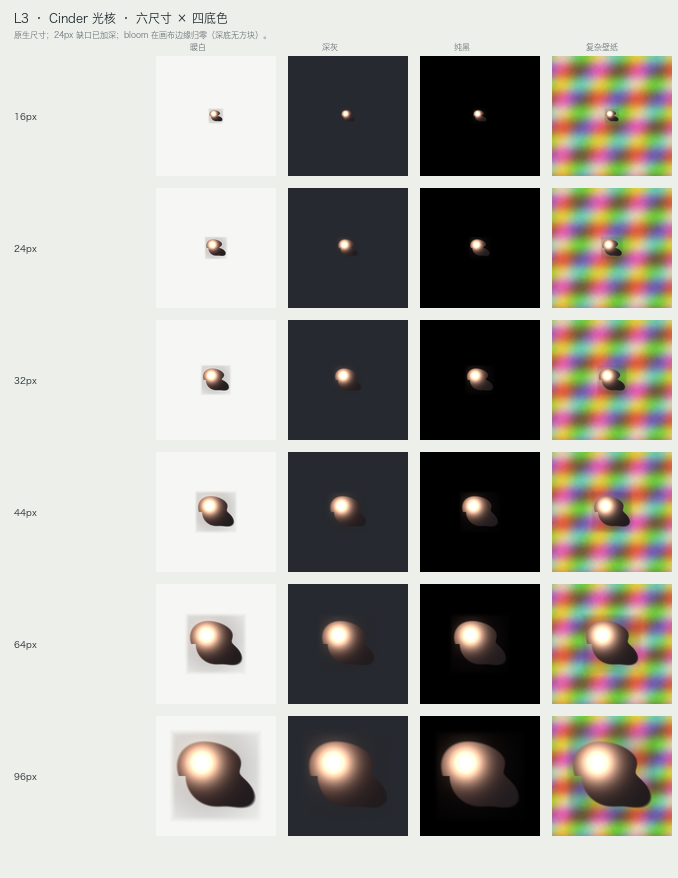

# L3 · Cinder 光核 · 定型

你选定 L3。这里把它推进到"可以作为品牌符号定稿"的程度，**仍未接入 App**。

---

## 1. 本轮只做一件事：让它在 24px 不塌成一个点

上一版的问题是 16–24px 退化为一个亮点，轮廓消失。我试了三种校正，并**否掉了两种**：

| 方案 | 做法 | 结果 |
|---|---|---|
| C1 光池放大 | 小尺寸时光池相对本体变大 | **否掉**：本体被光吞掉，变成一盏灯 |
| **C2 缺口加深** | 44px 以下"凹侧"加深，轮廓在 2–3px 内保住 | **采用** |
| C3 两者 | C1+C2 | 否掉：光抢戏，形变糊 |

判定依据是同尺寸最近邻放大对照：`out/cinder-24px-modes.png`。

## 2. 最终几何与参数

```
轮廓    r(θ) 由三部分合成：隆起(swell 0.26 @ -2.55rad)
        + 肢(limb 0.34 @ 0.62rad) + 凹口(notch)
凹口    基础 0.16；44px 以下额外加深 0.55×(1-px/44)
体色    #1E1B1E（墨），受顶左主光调制
光池    中心 (-0.30,-0.28)，半径 0.30，HI #FFE9C7 → MID #E4986E
bloom   0.30，单层；**画布外 18% 强制归零**（否则深底会留下方块）
渲染    numpy 4× 超采样降采样，一次成型，无逐帧成本
```

边界 alpha 实测 = **0**，可安全叠在任意桌面背景上。

## 3. 交付



```
out/cinder-board.png            六尺寸 × 四底色
out/cinder-final-{16..96}.png  原生尺寸（含 -light / -dark）
out/cinder-material.png         96px 材质放大（仅展示细节，不作判据）
out/cinder-on-page.png          B+ 页面比例合成稿（非 App 截图）
out/cinder-icon-512.png         应用图标（真实 512/1024 渲染，非放大）
out/cinder-icon-1024.png
out/cinder-24px-modes.png       C1/C2/C3 三方案 24px 对照
cinder.py                       可重建源码
```

## 4. 与上一版相比的真实变化

- 24px：有了明确的凹凸轮廓，不再是一个点。
- 深底：本体边界可见（墨色体 + 暖核），不再是"一团光"。
- 画布边缘：从"有方块"到"alpha=0"。

## 5. 仍然存在的问题

1. **16px 仍然塌**：这个尺寸里本体只有约 5 个像素，任何轮廓都保不住。若必须支持 16px，
   需要另一套编码（例如只保留"光池 + 一个缺角"），那属于新设计，不在本轮。
2. **偏暖偏橙**：与 B+ 的瓷白 + 赤陶体系不完全同温，接入前需要一次并置校验。
3. **光核同心**：光池位置固定，缩小后容易读成"指示灯"。C2 缓解但没有根治。
4. **未做真人识别测试**：`USER_STUDY_PENDING`。
5. **未接入 App**：没有桌面实拍、没有动效、没有性能数据。

## 6. 如果要进 App，下一步是什么

不是继续改形状，而是：

1. 在实验分支接一个可切换渲染器（同 A2 的做法），保留回滚；
2. 真实桌面实拍 24/44/96；
3. 与 B+ 并置做一次颜色校验（允许小幅调温，不改轮廓）；
4. 通过后再谈动效。

**没有你的授权我不会做上面任何一步。**
