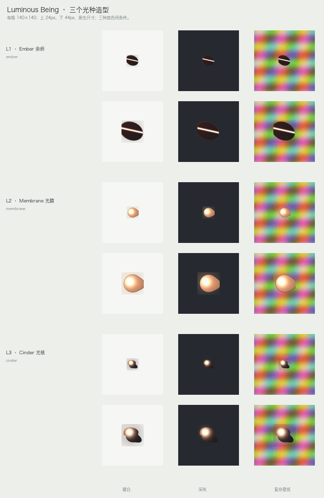

# F3.9 · Luminous Being 光学生命体 · 三个概念

**纯设计研究，未接入 App、未改生产代码、未做传光动画。**
A2-Signature + T2 已按你的结论冻结归档，不再调参。

---

## 1. 三个造型不是同一形状的三种画法

它们对应三种**光学原理**，所以形体差异是从原理长出来的，不是造型游戏：

| | 原理 | 形体 | 光的所在 |
|---|---|---|---|
| **L1 Ember 余烬** | 光**穿过**本体 | 倾斜的豆形，边缘不规则 | 一道贯穿的暖缝 |
| **L2 Membrane 光膜** | 表面**就是**光 | 躺下的水滴，带一条尾巴 | 整个壳，最亮在球部 |
| **L3 Cinder 光核** | 光从核心**逃逸** | 逗点形，一头重一头收 | 汇聚在一端 |



全部为**原生尺寸**（上 24px / 下 44px），三种底色同条件，无放大美化。
暖白、深灰、合成壁纸（未读取你的桌面）。

## 2. 各自最像什么（自查，不为它辩护）

**L1 Ember**
- 像：日食、眯起的眼睛、投币口。
- 优势：24px 下仍然是一个**有方向的暗体 + 一条亮缝**，四个方案里唯一在 24px 有内部结构的。
- 风险：那条缝太直、太亮，容易读成符号（禁止标志/眼睛），而不是光。

**L2 Membrane**
- 像：卡通水滴、暖色胶囊。
- 优势：44px 下有明确的"活物"感，尾巴让它不是完美圆形。
- 风险：暖橙色偏离 B+ 的瓷白体系；缩小到 24px 只剩一个暖点。

**L3 Cinder**
- 像：发光的豆子/贝壳。
- 优势：44px 轮廓最不对称，头重脚轻，有"存在"的重量。
- 风险：24px 时"肢"完全消失，退化为一个点。

## 3. 三个都不像什么（本轮要求排除的）

- 不是玻璃球：L1/L3 的体是哑光深色，没有高光斑；L2 虽亮但无镜面反射。
- 不是相机光圈：没有任何多瓣对称结构。
- 不是按钮：没有圆角矩形底板、没有居中发光点。
- 不是火焰图标：没有火苗尖端。
- 不靠粒子、不靠强光晕：全部只有一层薄 bloom。

## 4. 材质与参数

```
体色      L1/L3 墨 #1E1B1E，L2 暖陶 #E2986E 系
内部光    L1 缝沿长轴偏移 +0.22x；L2 焦散在 (-0.26,-0.16)；L3 光池在 (-0.30,-0.28)
轮廓      r(θ) 由 1–3 阶谐波调制，L2 附加尾部项，L3 附加"肢"项
bloom     L1 0.22 / L2 0.34 / L3 0.30（单层，无多层叠加）
渲染      numpy 4× 超采样后降采样，一次成型
```

## 5. B+ 页面比例

`out/on-page-composite.png`：88px 符号 + 称号 + 家族数的页面**合成稿**。
**这是合成，不是 App 截图**——本轮按你的要求没有接入。

## 6. 原始文件

```
out/board.png                 三方案对照板
out/{ember,membrane,cinder}-{24,44,64,96}[-light|-dark].png   原始 PNG
out/material-64.png           64px 材质展示
out/on-page-composite.png     页面合成（非截图）
beings.py                     可重建的渲染源码
```

## 7. 未做

- 未接入 App、未做动效、未做五档等级、未做七态。
- 未做 512/1024 图标（等你选定形态后再做）。
- 无真人识别测试：**USER_STUDY_PENDING**。

## 8. 我的倾向（供你否决）

如果只能留一个：**L3 Cinder**。

理由：它是三个里唯一在 44px 就有"重量"和方向的——头重、有肢、不对称，
不像做出来的图标，像**存在的东西**。而 L1 太符号化，L2 太像水滴素材。

但 L3 在 24px 会退化成一个点，这一点需要下一轮单独解决（不要靠改形状，靠让"光池"在
小尺寸里承担身份）。

**我不替你选。三张图都在上面。**
