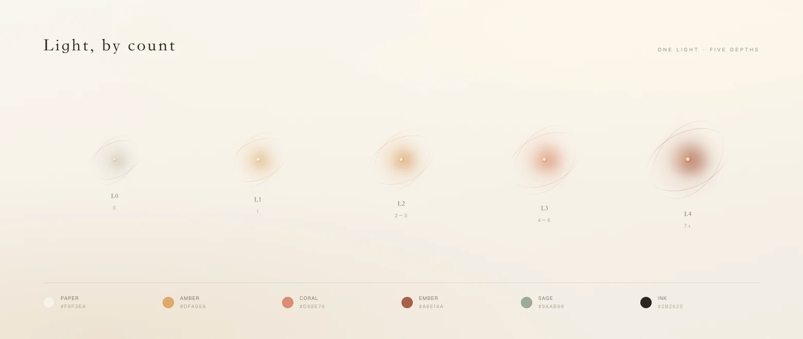

# 一束光 · 疗愈界面 / Warm Paper, Faint Light

> 一页纸、一束光、一句不催促的话。
> 这份设计稿不改变任何产品逻辑，只负责一件事：让「被点亮」这件事，看起来不像一次考核。

本目录是可以直接打开的设计原型，也是 README 里全部界面图的来源。
`index.html` 支持 `?lang=zh|en|fr|ja` 与 `?frame=home|scan|transfer|path|echo|moment|hero|levels`，
一份排版同时服务四种语言，避免四份设计各自漂移。

---

## 1. 三个判断

### 1.1 不做「仪表盘」
这个系统会数你用过几种 AI。数字一旦变成进度条、卡片、百分比，它就变成了绩效。
疗愈感的第一步，是把**数字放小、把光放大**：一屏只留一个数字重心，其余是留白。

### 1.2 光是安静的，不是炫的
不做霓虹、不做扫描线、不做粒子雨。
光只有四种表情：**渗**（在纸上慢慢洇开）、**呼**（11 秒一次的呼吸）、**散**（回响向外的水纹）、**亮**（一次确认）。
任何动画都不超过三个元素同时动。

### 1.3 界面是纸，不是屏幕
底色取未漂白的暖纸 `#F8F3EA`，叠一层 3.5% 的噪点；所有分隔只用 1px、透明度 11% 的 hairline；
不用卡片描边、不用阴影堆叠，靠留白分组。屏幕上出现的每一块「面」，都应该像纸，而不是像组件。

---

## 2. 色彩

| 名称 | 色值 | 用途 | 用量 |
| --- | --- | --- | --- |
| 温纸 Paper | `#F8F3EA` | 全局底色 | 主体 |
| 纸白 Paper-2 | `#FDFAF3` | 票根、二维码纸块 | 少 |
| 墨 Ink | `#2B2620` | 标题、正文 | 文本 |
| 雾灰 Fog | `#6D655A` | 次要说明 | 文本 |
| 淡痕 Trace | `#A49A8B` | 页码、标签 | 点缀 |
| 琥珀 Amber | `#DFA96A` | 微明 / 生长 | 光 |
| 珊瑚 Coral | `#D98E74` | 炽热 | 光 |
| 余烬 Ember | `#A8614A` | 深红 / 强调线 | 光 |
| 鼠尾草 Sage | `#9AAB98` | 对照色，只作色板 | 极少 |
| 夜 Night | `#202227` | 传光时刻 | 一屏 |

红的使用有上限：**任何一屏的暖色光面积不超过 6%**。超过就不再是微光，变成了警报。

---

## 3. 光点：五阶



| 光阶 | 可信家族数 | 核心色 | 光晕 | 呼吸 |
| --- | --- | --- | --- | --- |
| L0 沉睡 | 0 | 灰陶 `#B0A492` | 0.14 | 11 s |
| L1 微明 | 1 | 琥珀 `#DFA96A` | 0.22 | 11 s |
| L2 生长 | 2–3 | 暖金 `#DB9B60` | 0.28 | 11 s |
| L3 炽热 | 4–6 | 珊瑚 `#D98D70` | 0.34 | 11 s |
| L4 深红 | 7+ | 余烬 `#A8614A` | 0.40 | 11 s |

光点由四层叠成，全部是 CSS 渐变，没有位图：

1. **光核**：一个 6% 大小的白心 + 暖色径向渐变，带两层 box-shadow。
2. **雾**：两处不同相位的径向渐变，模糊 12px，制造斑驳。
3. **墨**：极低透明度的褐，模拟光落在纸上的湿痕。
4. **轨道**：两到三条 1px 的椭圆弧，128 秒转一圈；静止时也不对称。

呼吸只调制雾与轨道，光核几乎不动——真实的光是核稳定、空气在动。

---

## 4. 版式

| 项 | 规格 |
| --- | --- |
| 画板 | 390 × 844（移动端）；1600 × 760（主视觉）；1560 × 660（光阶研究板） |
| 边距 | 左右 30；页眉 30；底栏 26 |
| 正文 | 12.5 px / 行高 2 / 字距 0.02em |
| 标题 | 宋体 34 px（首页）、30 px（内页）、行高 1.42–1.62 |
| 小标签 | 9.5 px / 字距 0.34em / 全大写 |
| 分隔 | 1px / `rgba(43,38,32,.11)` |
| 底栏 | 四个词，当前项上方一条 22px 的朱砂短线 |

不设侧栏、不设 Tab、不设卡片。信息用**分隔线 + 留白**分组，一屏至少 40% 是空的。

---

## 5. 动效

| 动词 | 实现 | 时长 |
| --- | --- | --- |
| 渗 | 透明度与缩放同时到位 | 1200–2200 ms |
| 呼 | 正弦调制雾与轨道 | 11000 ms |
| 散 | 椭圆水纹向外扩大并变淡 | 11000 ms |
| 亮 | 光核一次极轻的脉动 | 700 ms |

- 缓动只用两条：`cubic-bezier(.16,1,.30,1)` 与 `cubic-bezier(.22,.61,.36,1)`。
- 不用 spinner、不用骨架屏、不用进度条、不用弹簧回弹。
- 尊重 `prefers-reduced-motion`；截图时用 `?still=0` 之外的默认静止模式，保证四语言出图一致。

---

## 6. 四屏 + 一瞬

| 屏 | 一句话 | 设计要点 |
| --- | --- | --- |
| 我的光 | 今天，也亮了。 | 光在页面中央偏上，标题压在留白里；三个数字等宽，不并列成卡片 |
| 点亮 | 先听一听，你的桌面。 | 三条许可先于按钮出现；「已经听见」用光点而不是复选框 |
| 传光 | 让另一束光，因你而开始。 | 一块纸作票根，二维码是纸上的印，不是屏幕上的码 |
| 光路 | 一条慢慢亮起来的路。 | 竖线时间轴，实心=已发生，空心=等待；末尾用虚线淡出，路还在继续 |
| 回响 | 你传出的一束光，今天又亮了。 | 最空的一页；三圈椭圆水纹与一句话 |
| 传光时刻 | 让光，去向另一个人。 | 唯一的一屏深色；两台手机的轮廓，一束光落进另一只手里 |

---

## 7. 文件与重新出图

```
design/healing/
  index.html     原型（四语言 + 八个取景帧）
  healing.css    设计语言：纸、墨、光、排版、动效
  healing.js     四语言文案 / 光阶 / 二维码道具 / 取景
  render.mjs     headless Chrome 出图 → assets/readme/{zh,en,fr,ja}/*.png
  optimize.py    PNG → WebP（约 900 KB / 29 张）
  calligraphy.py 朱砂底白字书法条幅「星星之火可以燎原」→ shared/sparks-spread.webp
```

```bash
# 需要本机 Chrome；puppeteer-core 路径按你的机器改 render.mjs 首行
node render.mjs
python3 optimize.py
```

截图使用设备像素比 2、静止模式，保证同一帧在四种语言下构图一致。

---

## 8. 书法条幅

`calligraphy.py` 生成 README 结尾那张朱砂底白字条幅。正文默认是「星星之火可以燎原」；
「星星之火可以疗愈」的版本同样保留在 `shared/sparks-heal.webp`，一条命令即可重出：

- 行楷（Xingkai SC）逐字落笔，每字 ±1.5° 旋转、±7px 错落，不做机械对齐
- 纸纹与飞白：alpha 乘以低频噪声，让笔画边缘像写在宣纸上，而不是矢量
- 一枚白印「光」，旋转 -4°，压在右下；左下是一行小字签名「hi，一束光」
- 1600×600，WebP 约 70 KB

```bash
python3 calligraphy.py "星星之火可以燎原" sparks-spread.webp
python3 calligraphy.py "星星之火可以疗愈" sparks-heal.webp
```

字体不在本机时，改 `FONT_CANDIDATES` 指向任意行楷 / 楷体文件即可。

---

## 9. 与主仓库视觉系统的关系

`docs/visual-system-v2.md` 是深色水墨版：适合桌面悬浮光点与夜间场景，墨 ≥ 88%、红 ≤ 2%。
本目录是**暖纸版**：面向白天、面向第一次打开的人、面向「被安慰」而不是「被震撼」。

两版共享同一条规则：**光只用加色，墨只用极淡的正片叠底；深浅只由证据决定，不由情绪决定。**
