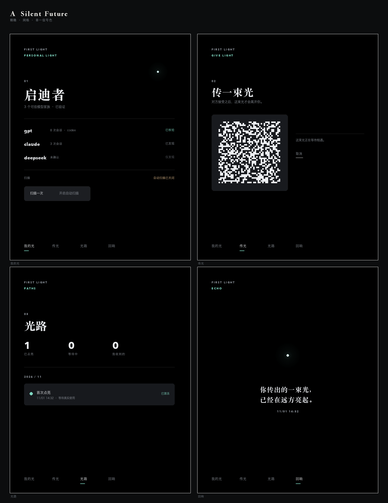
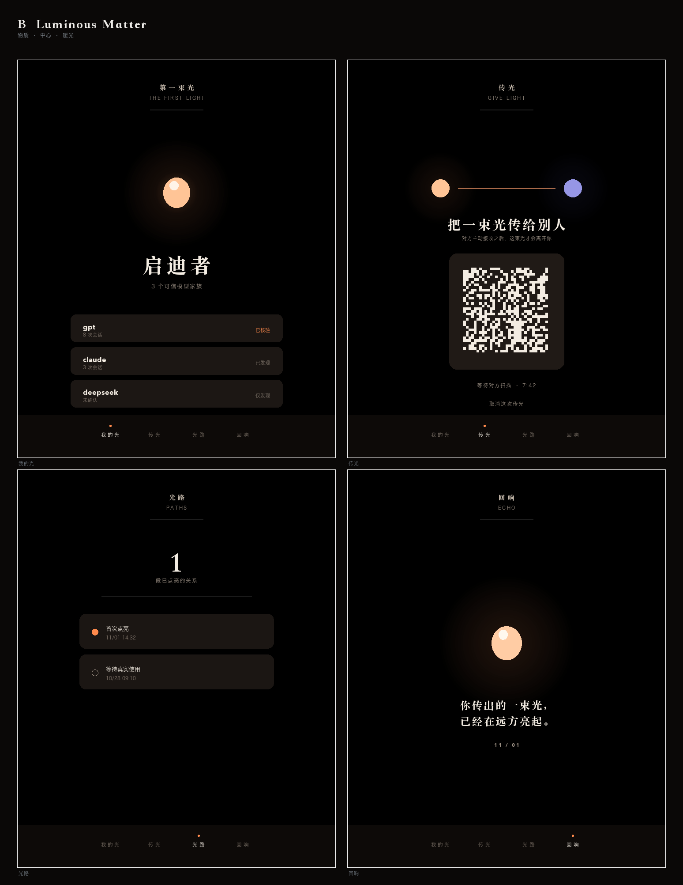
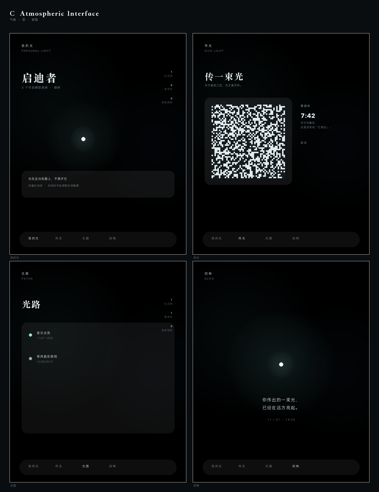
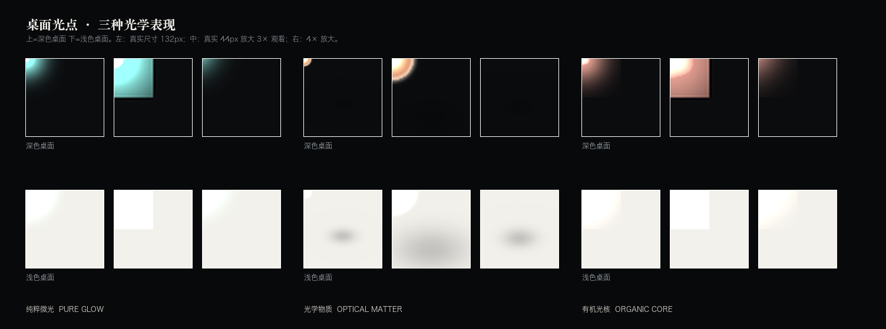

# UI 设计研究与视觉方向重构（R3-research）

**性质：设计研究，不修改生产界面。** 产品代码零改动，`apps/desktop/ui/` 未触碰。

---

## 0. 结论先行

- 现有 UI 的问题不是"不够高级"，而是**命中了几条公认的 AI 设计套路**，并且**信息秩序服务于装饰**。
- 三套方向都能成立，但**只有 A 在浅色桌面下不崩**——因为它的辨识度不依赖发光。
- 推荐：**A 为骨架 + B 的光点物理学**。理由见 §6。
- 光点研究的最大发现：**加色光在浅色背景上不可见**，这不是调参能解决的（§4）。

---

## 1. 来源审计

| 仓库 | 许可 | 星 | 最后推送 | 提供了什么 |
|---|---|---|---|---|
| [pbakaus/impeccable](https://github.com/pbakaus/impeccable) | **Apache-2.0** | 98.6k | 2026-10-31 | 62 条确定性 slop 规则、`critique`/`audit` 评分、`/impeccable init` 写 `PRODUCT.md`；README 明确列出 DeepSeek Harness |
| [anthropics/skills · frontend-design](https://github.com/anthropics/skills/tree/main/skills/frontend-design) | 见 LICENSE.txt（未声明 SPDX） | 186k | 2026-10-28 | 设计判断力：反模板清单、排版纪律、结构即信息 |
| [nextlevelbuilder/ui-ux-pro-max-skill](https://github.com/nextlevelbuilder/ui-ux-pro-max-skill) | **MIT** | 143k | 2026-11-01 | 跨平台 UI/UX 设计智能 |
| [vercel-labs/web-interface-guidelines](https://github.com/vercel-labs/web-interface-guidelines) | **MIT** | 1.1k | 2026-10-05 | 交互与可访问性准则（焦点、命中区、加载态） |

**没有安装任何一项。** 理由：

1. Impeccable 的安装路径是 `npx impeccable install`，会在仓库根写入 skills 目录并可能注册 agent 钩子；
   本轮要求"不直接修改生产界面"，任何会改变仓库结构的安装都超出授权。
2. 它是 Apache-2.0，可以引入；但引入时机应在**方向确定之后**，作为重构期的规则检查器，而不是研究期的脚手架。
3. 本轮使用的是它们的**方法论**（下述审计），方法论不需要安装即可应用。

来源可信度：四个都是活跃维护的公开仓库，许可明确可商用。`anthropics/skills` 未声明 SPDX，
若日后引入需单独确认 LICENSE.txt 全文。

---

## 2. 现有 UI 的设计问题审计

用 frontend-design 点名的"生成式设计套路"逐条对照 **我自己已交付的界面**（截图 `docs/reports/f3_6_r3/`）：

| 套路 | 是否命中 | 具体证据 |
|---|---|---|
| 近黑底 + 单一朱红点缀 | **命中** | 底色 `#0A0F16`，唯一强调色是朱砂系；正是该文第一条"tell" |
| 内容上方的装饰性 eyebrow | **命中** | 每页左上「第一束光」+ 下划线，不承载信息 |
| 编号标记 01/02/03 | 未命中 | 幸未使用 |
| 全大写标签 | 部分 | `PERSONAL LIGHT` 之类似有若无 |
| 逐段 fade-and-slide-up 入场 | 部分 | 每个视图切换都是 `page-in` 位移淡入 |
| 卡片堆叠 | 部分 | 光路/回响已去卡片，我的光仍是"分区块" |
| 大数字 + 小标签的默认英雄版式 | **命中** | 我的光的 `称号 + 家族数` 就是该模板 |

**更实质的三条问题（不依赖任何外部标准）：**

1. **信息秩序服从装饰。** 我的光里，光的尺寸、称号的字号、行距，都为了"像水墨"
   而设，而不是为了让人在 3 秒内读出状态。看截图：读完全页要扫 6 个区块。
2. **辨识度靠材质，不靠结构。** 去掉朱砂色和宋体，四页就退化成普通深色面板。
   一个合格的品牌识别应该在**灰度打印**时仍然认得出。
3. **小尺寸塌陷。** 光点在 132px 窗口里只有 10–14px 核心，缩小到 44px 时
   光晕直接出框（见 §4 中间一列），这在真实桌面上就是"一个小方块"。

---

## 3. 三套方向

每套 4 页（我的光 / 传光 / 光路 / 回响），**同一业务状态**：
称号「启迪者」、3 个可信家族、gpt 已核验 8 次、claude 已发现、deepseek 未确认、1 段已点亮、0 待激活。

### A · Silent Future

- **骨架**：左对齐 12 栏，56px 边距，1px 分隔线，无卡片。
- **字体**：中文宋体做标题（52/44/40），Avenir 做数字与微标签，正文 PingFang。
- **色**：石墨 `#101112`，单一冷信号 `#7ED6C0`，暖警示 `#D0B284`。
- **光**：右上角一枚**极小、极硬**的点（纯微光），不参与版面重心。
- **交互**：整行可点，focus 用 1px 冷色描边；无 hover 放大。
- **动效**：仅状态切换时 220ms 位移淡入；静息无循环动画。

### B · Luminous Matter

- **骨架**：居中对称，光为绝对主体，信息在光下方，卡片带柔和投影。
- **字体**：宋体为主（46/30/24），中文标题承担全部气质；数字用衬线。
- **色**：暖炭 `#14100E`，琥珀 `#FF8A4C`，冷紫作对照（传光页两颗光）。
- **光**：**光学物质**——玻璃珠质感，有边缘折射、镜面高光、接触阴影。
- **交互**：卡片整块可点；hover 提升 1px 阴影。
- **动效**：呼吸 6s，偏快；点击时核内高光位移。

### C · Atmospheric Interface

- **骨架**：全幅氛围渐变 + 右侧浮动玻璃面板，信息放侧栏，主区留给光。
- **字体**：全无衬线，字号偏小（36/17/11），字距加宽。
- **色**：深青 `#0F161A`，雾青 `#96E2D6`，玻璃 `rgba(255,255,255,.06)`。
- **光**：大范围弥散，无硬核（有机光核），像雾中灯笼。
- **交互**：玻璃面板可滚动；底部胶囊导航。
- **动效**：背景光斑极慢漂移（≥40s），面板入场 400ms。

---

## 4. 光点三种光学（真实尺寸优先）

| | 纯微光 | 光学物质 | 有机光核 |
|---|---|---|---|
| 深底 | 干净、像信号 | **最有物理存在感** | 有呼吸感，但边缘略软 |
| 浅底 | 几乎不可见 | 可见（有阴影与边缘） | 隐约可见 |
| 44px 下 | **光晕出框成方块** | 仍能读出"一颗珠子" | 糊成一团 |

**三个必须记录的发现：**

1. **加色光在浅色桌面上必然失效。** 米白底上，光只能"加亮"，而白已经到顶。
   任何靠 glow 建立辨识度的方案（B、C）在浅色壁纸上都会消失。
   唯一的物理出路是 B 的**接触阴影 + 边缘折射**——它靠"遮挡"而非"发光"存在。
2. **44px 会出框。** 因为光晕半径大于画布的一半。这不是美术问题，是画布尺寸问题：
   要么画布随尺寸放大，要么光晕在小尺寸下整体收缩。
3. **小尺寸下细节全部丢失**，只剩轮廓与明度。所以"材质复杂度"在小尺寸没有价值，
   有价值的是**明度对比与轮廓形状**。

---

## 5. 取舍与可实现性

| | A Silent Future | B Luminous Matter | C Atmospheric |
|---|---|---|---|
| 实现成本 | **低**（纯 CSS 布局 + 1 个 canvas 点） | 中（玻璃珠需要多层合成） | 中高（模糊层 + 玻璃面板） |
| 性能风险 | **极低**，静息零动画 | 中（阴影/模糊需持续合成） | 高（全幅模糊） |
| 浅色桌面 | **不受影响**（不靠发光） | 依赖阴影，可成立 | **会崩** |
| 灰度可辨识 | **是** | 部分 | 否 |
| 品牌特性 | 强（克制、精确） | 中（好看但易与同类撞） | 弱（玻璃拟态是通用语言） |
| 与现有令牌的兼容 | 高（改色板即可） | 中（需新增材质令牌） | 低（需重写布局） |

---

## 6. 推荐

**以 A 为骨架，借用 B 的光点物理学。**

理由不是审美偏好，是证据：

1. 浅底测试证明，**靠发光的辨识度不可移植**；A 的辨识度来自排版与网格，灰度下也成立。
2. A 的信息秩序能直接回答"3 秒内看懂状态"——B/C 都把注意力放在光上而不是状态上。
3. 但 A 现在的光点太弱（§4 中间列）。**用 B 的接触阴影 + 边缘折射**替代纯 glow，
   既保留物理存在感，又不依赖加色，因此浅底也成立。

**如果最终选 A，必须同时改三件事**：去掉装饰性 eyebrow、重排我的光的信息优先级
（称号 > 状态 > 家族明细 > 扫描）、以及把小尺寸光点的画布策略改掉。

---

## 7. 工程边界

- 生产 UI 未改动：`apps/desktop/ui/`、`tokens.json` 均未触碰。
- 未修改 RootIdentity / E3-E4 / 状态机 / 扫描授权 / Keychain / 服务端 API / SSE。
- **两个未完成真机验收项保持未通过**：
  - 非激活窗口真实首次点击（仅合成路径 10/10）
  - Keychain 成功路径（只有拒绝路径被真机验证）

## 8. 本研究的不足

- 三套页面是 **PIL 渲染的设计稿**，不是运行截图；字体度量与真实 WebKit 有差异。
- 只测了一种业务状态，未测空态/错误态在三套方向下的表现。
- 光点研究只有单帧，未验证动效观感。
- 未安装 Impeccable 做规则复核，属于方法论应用而非工具验证。
