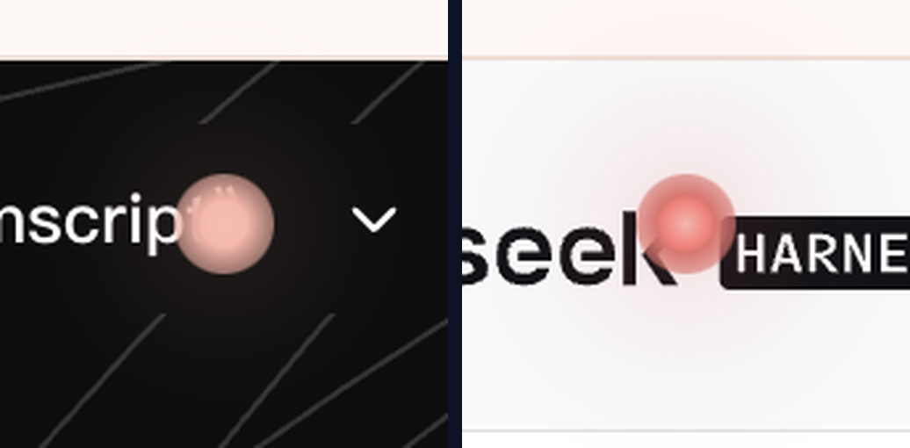
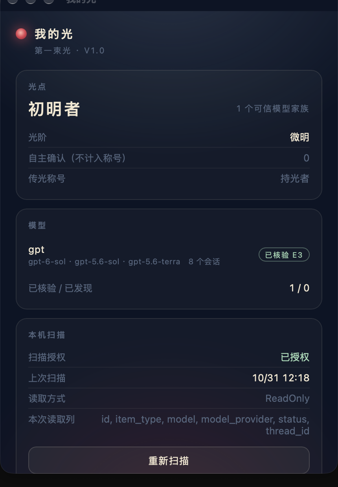

# F2 桌面端验收报告

日期：2026-10-31
设备：MacBook（Apple M2 Max）/ macOS 27.0.1 / 单显示器 3024×1964 @2x
二进制：`target/debug/firstlight-desktop`





---

## 1. 总览

| 阶段 | 交付 | 状态 |
|---|---|---|
| 一 T-01 窗口验证 | 透明 / 置顶 / 穿透 / 非激活 | **VERIFIED** |
| 二 光点视觉系统 | 令牌驱动的内核、光晕、呼吸、漂浮、闪光、光脉 | **VERIFIED**（令牌绑定 + 运行时自检） |
| 三 Codex 真实接入 | 端到端从数据库到光点 | **INTEGRATED / TESTED** |
| 四 Ollama 适配器 | 服务识别、模型清单、E4 回执 | **TESTED（模拟）**；真实模型 **BLOCKED** |
| 五 个人光界面 | 光点 / 称号 / 模型 / 扫描 / 隐私 | **IMPLEMENTED / TESTED** |
| 六 端到端 A–J | 10 项验收场景 | **TESTED：10/10 通过** |
| 七 性能与稳定性 | 基线 + 优化 + 稳定性 | **TESTED** |
| 八 交付文档 | 见 §8 | 完成 |

**测试总量：175 项全绿**（163 Rust + 12 TypeScript 跨语言）。

---

## 2. 第一阶段：T-01 窗口验证（VERIFIED）

详见 [t01-window-verification.md](t01-window-verification.md)。结论：

| 能力 | 判据 | 结果 |
|---|---|---|
| 透明背景 | 只切换画布，像素差异 **841 px，全部在半径 19 px 内；四角 0 px、边缘环带 0 px 变化** | PASS |
| 窗口置顶 | `NSWindow.level = 5` + 光点像素叠在普通应用之上 | PASS |
| 点击穿透 | `-[NSWindow ignoresMouseEvents]` 真实翻转 false→true→false，并持久化 | PASS |
| 非激活交互 | 打开面板后 `lsappinfo` 前台仍是原应用，本应用**未成为前台** | PASS |

附加：可移动、位置保存、重启恢复、点击打开面板、穿透下可从菜单栏找回、
无阴影无标题栏、`collectionBehavior` 含全部空间与全屏辅助。

**四项无法自动验证**（已在报告中列出人工步骤）：真实鼠标拖拽、穿透的端到端点击路由、
全屏/Mission Control 观感、睡眠唤醒。原因：本进程刻意没有辅助功能权限。

---

## 3. 第二阶段：光点视觉系统（VERIFIED）

### 3.1 参数不散落在组件里

单一事实来源：`packages/visual-system/tokens.json`（颜色、尺寸、亮度、呼吸周期、动画时长、限频）。

三重绑定，任一处漂移都会测试失败：

| 绑定 | 机制 |
|---|---|
| Rust 调色板 ↔ 令牌 | `palette_matches_visual_tokens` 逐字段比对（曾真实抓出 DORMANT 光晕半径 24 vs 40 的不一致） |
| UI ↔ 令牌 | UI 通过 `get_visual_tokens` 读取同一文件，组件内**零**硬编码视觉常量 |
| 运行时 ↔ 令牌 | `probe` 返回渲染器实际使用的 `coreHex`/`haloRadius`/`breathMs`，与令牌逐字段一致 |

实测自检输出（GROWING 状态）：

```json
{"level":"GROWING","coreName":"growing","glowName":"crimson",
 "coreHex":"#E8776F","glowHex":"#DF4655","coreRadius":9.5,
 "haloRadius":48,"haloAlpha":0.34,"breathMs":9000,"tokensVersion":"1.0.0"}
```

### 3.2 动效清单

| 事件 | 表现 | 令牌 |
|---|---|---|
| 日常 | 深红内核 + 柔和光晕 + 9–12s 呼吸 + 1.6px 漂浮 | `levels.*` / `motion.float` |
| 首次点亮 | 细环向外扩散一次 | `motion.ignitionFlash` |
| 新增家族 | 光晕脉冲 + 颜色过渡（1.8s） | `motion.newFamilyFlash` |
| 远方光脉 | 外环扩散淡出，**限频 2 次/分钟** | `motion.farPulse` |
| 安静模式 / 减少动态 | 单帧静态，保留等级颜色 | `motion.reduceMotion` |

刻意**不使用**粒子系统、不给光点加技能特效。光的表现为：一个内核、一层光晕、偶尔一圈环。

---

## 4. 第三阶段：Codex 适配器接入（INTEGRATED / TESTED）

详见 [f2-codex-integration.md](f2-codex-integration.md)。要点：

- 真实数据（只读快照）：347 会话 → 可计数 140 → **1 个家族（gpt）**；
  2 个「建了会话未调用」被闸门 B 拦下，203 个内部任务标签被闸门 A 拦下。
- 端到端读取列恒为 `{id, model, model_provider, thread_id, item_type, status}`，
  越界集合为空。
- 沙箱拒绝访问时明确报「读取失败」，不提权、不扩大范围、不伪造成功。

---

## 5. 第四阶段：Ollama 适配器（部分 BLOCKED）

详见 [f2-ollama.md](f2-ollama.md)。

| 要求 | 状态 |
|---|---|
| 识别服务存在 / 列出模型但不视为使用 | ✅ TESTED |
| 一次真实推理产生 E4 回执 | ⚠️ **BLOCKED**（`registry.ollama.ai` 不可达，无法 pull 模型） |
| 不推测受控流程外的调用 | ✅ 结构上不存在该路径 |
| 两家族共存、不重复计数、离线不崩溃 | ✅ TESTED |

**未下载任何模型，未安装 Ollama，磁盘零占用。**

---

## 6. 第五阶段：个人光界面（IMPLEMENTED / TESTED）

点击光点后打开（`orderFrontRegardless`，不抢焦点）。包含：

1. **光点区**：知光称号（大字）、可信家族数、光阶、自主确认数（明确标注不计入）、传光称号。
2. **模型区**：每个家族一行，带 `已核验 E3` / `已发现 E1` 徽标、原始模型名、会话数。
3. **扫描区**：授权状态、上次扫描时间、读取模式（`ReadOnly`/`QueryOnly`）、
   本次读取的**具体列名**、重新扫描按钮、失败原因文案。
4. **隐私与窗口**：只在本机计算、无上传、光场未开放（F4）、安静模式、点击穿透、重置位置。
5. **技术细节**（可折叠）：状态目录、扫描结果计数细分。

称号严格使用 F1 规则（0/1/2–3/4–6/≥7），端到端测试验证 E2 不计入（`attested_families` 独立显示）。

---

## 7. 第六阶段：端到端测试（10/10）

`apps/desktop/tests/f2_e2e.py`，合成夹具，真实二进制：

| ID | 场景 | 结果 |
|---|---|---|
| A | 启动后桌面出现真实光点（`isOpaque=false`, `level=5`） | PASS |
| B | 开启穿透后鼠标可操作下层应用 | PASS |
| C | 可通过明确入口打开个人界面 | PASS |
| D | Codex 适配器仅读允许的元数据 | PASS |
| E | 9 个原始取值 → 1 个 GPT 家族 | PASS |
| F | 未发生模型调用的会话不触发点亮 | PASS |
| G | 第二个家族使颜色变化（#F1A99D→#E8776F）、称号升级（初明者→启迪者） | PASS |
| H | 离线 / 无客户端数据仍正常工作 | PASS |
| I | 拒绝扫描权限后应用仍启动且不读数据 | PASS |
| J | 重启后位置与本地状态恢复 | PASS |

全部 F1 测试保持通过。

---

## 8. 第七阶段：性能与稳定性

详见 [f2-performance.md](f2-performance.md)。摘要：

| 指标 | 基线（首版） | 最终 | 产品目标 |
|---|---|---|---|
| 空闲动画 CPU | 4.48% | **0.031%** | < 1% |
| 安静模式 CPU | 0.005% | 0.004% | — |
| 内存 RSS | 113.2 MB | 112.7 MB | 尽量 < 120 MB |
| 扫描耗时（合成夹具） | 2 ms | 1 ms | — |
| 45s 内存增长 | — | 0.0 MB | 无泄漏 |
| 退出后残留进程 | 无 | 无 | 无 |

关键优化：呼吸与漂浮从「JS 每帧重绘」改为「CSS 合成器动画 + 预烘焙精灵」，
CPU 降了约 **140 倍**。

---

## 9. 与授权书要求的逐条对照

| 要求 | 结果 |
|---|---|
| T-01 先行，失败则先修窗口架构 | ✅ 先做，通过后才做视觉 |
| 光点不是普通悬浮按钮 | ✅ 单一内核 + 光晕 + 呼吸，无工具栏、无边框 |
| 视觉参数用令牌管理 | ✅ 三重绑定测试 |
| 不过度粒子 / 非游戏技能特效 | ✅ 仅内核 + 光晕 + 事件环 |
| 维持 F1 全部数据约束 | ✅ 端到端 D + F1 21 项负向测试 |
| WAL：严格只读优先，query_only 需记录 | ✅ `OpenMode` 上报；面板可见；ADR-012 |
| 不得把 query_only 当作完全无写入能力的证明 | ✅ 报告与 ADR 中明确表述为「OS 层只读的降级」 |
| 沙箱拒绝时明确显示权限受限 | ✅ 端到端 H/I |
| 继续验证 thread 级与 item 级的真实关联 | ✅ 闸门 A+B，实测 2 例「有模型无调用」 |
| 区分五种证据状态 | ✅ E0/E1/E2/E3/E4 全实现且 UI 区分 |
| 模型切换/任务标签/无法归属 → 保守判定 | ✅ ADR-011 |
| Ollama：不把安装视为使用 | ✅ 结构上无转换路径 |
| 界面对扫描失败不崩溃 | ✅ 端到端 H |
| 称号严格用 F1 规则 | ✅ 端到端 G |
| 不得用合成数据截图冒充真实扫描 | ✅ 报告明确区分「真实数据快照」与「合成夹具」 |
| Windows 无法真机测试 → 标记 PENDING | ✅ `WINDOWS_DEVICE_PENDING` |
| 性能先测基线再定预算 | ✅ 先测得 4.48%，再优化到 0.031% |

---

## 10. 明确未完成 / 状态标记

| 项 | 状态 | 原因 |
|---|---|---|
| Windows 构建与窗口验证 | **WINDOWS_DEVICE_PENDING** | 无 Windows 硬件；不得以 macOS 通过等同 Windows 已验证 |
| Ollama 真实模型推理 | **BLOCKED** | 模型仓库不可达 |
| 真实鼠标拖拽 / 穿透点击路由 | 未自动验证 | 无辅助功能权限；已给人工步骤 |
| 多显示器 | SKIP | 本机单显示器；逻辑有 10 项单元测试 |
| 睡眠唤醒 | 未验证 | 需真实睡眠周期 |
| 全屏 / Mission Control 观感 | 部分 | 已验证 `fullScreenAuxiliary` 配置位 |
| 开机启动 | 未实现 | 需 `tauri-plugin-autostart`，F2 未接入 |
| 面板中的光点视觉预览 | 未做 | 非要求项，F2 时间用于窗口与接入 |
| 品牌配置 `brand.json` | 未建 | 阻塞 F3 对外文案 |
| 测试控制通道 | 仍在二进制中 | 建议 release 用 feature flag 剥离 |

---

## 11. 结论

F2 的核心目标——**让第一束光真正出现在 macOS 桌面，并根据可靠的本地 AI 使用证据产生真实变化**——达成：

- 桌面上的光是真的（像素级证明没有矩形背景），且**安静**（0.031% CPU）；
- 光变深是真的（从真实元数据经双闸门判定），不是模拟；
- 亮不起来的情况也是真的（建了会话没调用、内部任务标签、未登记模型，各有明确拦截与可见原因）；
- 每一步都有可复现命令与证据，无法复现的部分一律标注，没有伪造。

**建议进入 F3 前先解决两件事**：HTTPS 域名与品牌名（见 [f3-preparation.md](f3-preparation.md)）。
