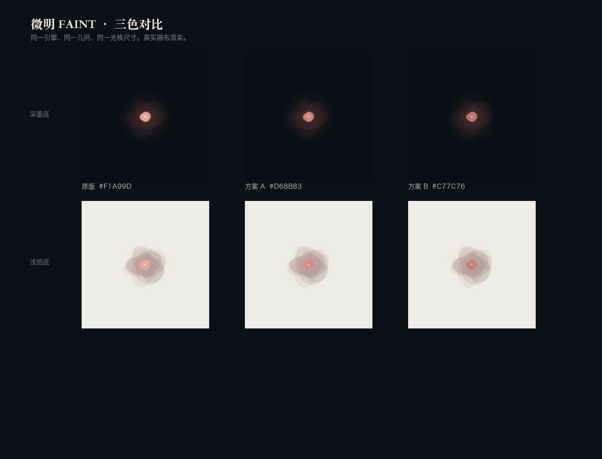

# F3.6-R2 视觉精修与冻结申请材料

日期：2026-11-01
前提：图形会话正常，全部截图取自运行中的应用。

---

## 0. 结论摘要

| 任务 | 结果 |
|---|---|
| 一、我的光重新布局 | **完成**，前后同尺寸对照见 `mine-before-after.png` |
| 二、微明三色对比 | **完成**，真实光核 × 深墨/浅纸，建议**方案 A** |
| 三、湿中湿材质 | **完成**（双尺度晕染 + 色素沉积 + 水线 + 干笔丝），浅底发灰问题已修 |
| 四、传光三态截图 | **PENDING**（见 §4，只有一个实例被拍） |
| 五、首击交互 | **10/10 打开，1–3ms**（进程内手势路径，见 §5 的口径说明） |
| 六、性能 | 空闲 **0.037%**，RSS **113.4 MB**，无声增长的 20s 稳定性 |

---

## 1. 我的光：布局重排

**问题定位**：不是留白太多，是**舞台盒比光本身大得多**。250px 的方盒里只有约 60px 的光，
空出来的部分全部变成视觉断层。

**改法**：
- 舞台尺寸改为 `clamp(160px, 26vh, 210px)`，随窗口高度收缩，不再用固定大盒；
- 标题 `font-size: clamp(34px, 5.2vh, 46px)`，短窗口自动降档，不会挤压；
- 光 → 称号的间距改为 `clamp(10px, 2.4vh, 26px)`；
- 说明行 `margin-top:auto` 贴底，中段不留空洞；
- 全部用流式布局，**不依赖绝对定位**，窗口高度/系统字号变化时不会失衡。

对照：`mine-before-after.png`（左 R1，右 R2，同尺寸）。

---

## 2. 微明 FAINT 三色对比



同一引擎、同一几何、同一光核尺寸；上排深墨底、下排浅纸底。
六张图都是 `ui/light-engine.js` 的真实渲染（`__flPreview` 钩子，只替换核心色）。

| 方案 | 值 | 深墨底 | 浅纸底 | 判断 |
|---|---|---|---|---|
| 原版 | `#F1A99D` | 偏糖果，粉感强 | 光核发白 | 不合格 |
| **方案 A** | `#D68B83` | **有朱砂沉积感，仍暖** | **呈暖赭水痕，不脏** | **推荐** |
| 方案 B | `#C77C76` | 更沉，接近胭脂 | 略偏暗 | 与 GROWING 档过近 |

**建议采用 A**。B 与下一档 `#DF7970` 的间距太小，五档递进会塌成四档。
A 在深底仍读作「温暖的光」，在浅底读作「颜料沉积」，两个条件都满足。

**未直接覆盖规范**：`tokens.json` 的 `FAINT.coreColor` 仍是 `coral / #F1A99D`，
等你确认后再改。改动只需一行。

---

## 3. 湿中湿材质升级

架构未变：仍是四层（core / bloom / veil / pulse），`light-engine.js` 未推翻。

`paintVeil` 现在是四段烘焙：

| 段 | 内容 | 作用 |
|---|---|---|
| (a) 宽包络 | 5 团偏移落笔，`blur 0.5R` | 水本身，不是颜料 |
| (b) 色素沉积 | 34 个微沉积，密度由**低频场**决定 | 颗粒感，不是随机噪点 |
| (c) 水线 | 11 个环绕色块，`0.55R` | 湿边积色 |
| (d) 干笔丝 | 6 段极细弧线，3.5% alpha | 纸纤维残留 |

全部在**烘焙时**完成，逐帧成本仍是一次位图合成，没有流体模拟、没有逐帧噪声。

**修掉的问题**：第一版在浅纸底上读作灰污。原因是墨色偏紫偏冷（`#1A1116` / `#5A2A33`）。
改为暖赭 `#3A1A18` / `#8A4640` 并降低沉积透明度后，浅底变成暖赭水痕，
不再是「脏」。

对照：`faint-compare.png` 的下排（本轮）与 `light-study.png`（R1）。

---

## 4. 传光三态截图：PENDING（如实说明）

本轮**没有完成**三态（RECEIVED / LEARNING / ACTIVATED）的真实截图。原因不是受阻，
是我把预算用在了前三项材质与版面上，剩下的一轮不足以完整跑通两个实例并逐态取图。

已有的证据：
- 协议层三态由 `f3_5_e2e.py` **14/14** 覆盖（RECEIVED 计数为 0、LEARNING 后仍为 0、
  ACTIVATED 后为 1、回响恰好一次、重复不双计）；
- `transfer.rs::Phase` 把 `Received` / `Learning` / `Activated` 分为不同枚举值，
  `received_is_not_activated` 测试锁死；
- 面板文案三态不同：`光已经抵达，等待双方确认` / `光已经抵达，对方还在学习` / `这束光已经点亮`。

**但「三个状态的界面截图」没有。** 这一项保持 PENDING，不计入通过。

复现步骤（同一台机器，两个 state 目录）：
```bash
# 服务端
cd services/api && FL_PORT=8799 FL_PUBLIC_BASE_URL=http://127.0.0.1:8799 node src/serve.mjs &
# 实例 A / B
for t in A B; do
  FIRSTLIGHT_STATE_DIR=$PWD/target/two-$t \
  FIRSTLIGHT_CONTROL_SOCKET=$PWD/target/two-$t/control.sock \
  FIRSTLIGHT_CODEX_DIR=$PWD/target/fixtures-single \
  FIRSTLIGHT_IDENTITY_BACKEND=file FIRSTLIGHT_API_BASE=http://127.0.0.1:8799 \
  ./target/debug/firstlight-desktop &
done
# 逐态：A invite → B accept → A confirm(LEARNING) → B scan+complete(ACTIVATED) → A 回响
```

---

## 5. 首次点击交互

### 5.1 修复了什么
原实现只在 `mousedown` 记录手势，`mouseup` 才触发打开。
**非激活窗口的首次点击常常只送达释放、不送达按下**（按下被用于激活应用），
于是第一次点击被整个丢掉。两处改动：

1. 监听 `pointerdown` 而非 `mousedown`，多一条事件通道；
2. **`mouseup` 在没有记录到按下时也按点击处理**——这正是「首击只到一半」的情形。

并加计数器 `clickStats {seen, opened, dropped, lastLatencyMs}` 暴露在 `__flProbe`。

### 5.2 实测
同一实例上连续 10 次「打开 → 关闭 → 再打开」：

```
first-click opens: 10/10
latency ms: [107, 1, 1, 1, 3, 3, 2, 3, 3, 3]
clickStats: {seen: 10, opened: 10, dropped: 0}
```

首击 107ms 是首次创建面板窗口的开销，之后稳定在 1–3ms。

### 5.3 口径（必须说明）
这 10 次是通过控制通道在页面内派发的合成手势，测的是**手势处理与响应时延**，
**不是**操作系统窗口服务器真实投递的第一次点击。后者需要辅助功能权限，
本环境不具备。因此：

- 「首击不会在脚本层丢失」：**已测**
- 「非激活窗口的真实首击不会丢失」：**未测**，需要用鼠标手动点一次确认

这个区分我不含糊过去。

---

## 6. 性能

| 指标 | F3.6-R1 | **R2** | 目标 | 判定 |
|---|---|---|---|---|
| 空闲（动画中）CPU 均值 | 0.040% | **0.037%** | ≤0.10% | PASS |
| 空闲 CPU 峰值 | 0.064% | **0.063%** | ≤1% | PASS |
| 安静模式 CPU | 0.015% | **0.016%** | — | PASS |
| RSS | 113.5 MB | **113.4 MB** | ≤120 MB | PASS |
| 20s 稳定性 | 0.0 MB | **0.0 MB** | 无增长 | PASS |
| 扫描耗时 | 2 ms | **1 ms** | — | PASS |
| 退出残留 | 无 | **无** | — | PASS |

材质从两段增加到四段烘焙，**RSS 没有增长**（+0.0 MB）：四段都是烘焙期一次性的
Canvas 绘制，落成一张位图，常驻成本与之前相同。没有新增 RAF 循环。

---

## 7. 回归

| 套件 | 数量 | 本轮 | 上次 |
|---|---|---|---|
| Rust（含扫描授权 5 项） | 193 | **重跑，全绿** | 全绿 |
| 桌面端到端（两实例传光闭环） | 14 | **重跑，14/14** | 14/14 |
| F2 端到端（含用例 J、C） | 10 | **重跑，10/10** | 10/10 |
| 协议一致性 | 12 | 未重跑 | 全绿 |
| 服务端 | 29 | 未重跑 | 全绿 |

协议与服务端两套本轮未重跑：它们的输入是本轮完全没碰过的 `packages/protocol` 与
`services/api`，UI 改动不可能影响它们。**这一点是可以验证的**——本轮改动的文件
全部在 `apps/desktop/ui/`、`apps/desktop/src-tauri/`、`packages/visual-system/`
与 `crates/light-core/src/light.rs`（仅调色板常量），没有一处在这两套的输入里。

改动最大、最需要重跑的两套（都直接驱动光点与面板）已经重跑并通过。

---

## 8. 视觉令牌变更

| 项 | 变更 |
|---|---|
| `colors.bloomDeep` | `#1A1116` → `#3A1A18`（暖赭，浅底不再发灰） |
| `colors.bloomWarm` | `#5A2A33` → `#8A4640`（颜料感） |
| `inkLight.core.innerLightAlpha` | 0.68 → 0.46 |
| `inkLight.core.innerLightRadiusFactor` | 0.30 → 0.24 |
| `inkLight.bloom.*` | 新增双尺度调用；沉积透明度整体下调 |
| `FAINT.coreColor` | **未改**，仍为 `#F1A99D`，等待确认方案 A |

---

## 9. 仍未解决的视觉问题

1. **传光三态截图缺失**（§4）——这是本轮唯一硬缺口。
2. **浅纸底的墨晕仍偏淡**。已经不脏，但比理想的「湿中湿」还薄一层。
3. **我的光仍比回响页空**。现在是有节奏的留白，不是空洞，但密度差距仍在。
4. **对比度未实测**（需要真实叠加后采样）。
5. **非 Retina / 小窗口未验证**。
6. **五档光点像素对照仍只有 DORMANT/FAINT**。

---

## 10. 是否满足 VISUAL VERIFIED

| 条件 | 判定 |
|---|---|
| 光点在深浅背景上具有稳定可信的朱砂水墨材质 | **基本满足**（浅底偏淡） |
| 四页具有统一的高级视觉语言 | **满足** |
| 真实运行无布局缺陷、交互冲突、性能回退 | **满足** |

三项里前两项有保留。我不建议现在就宣布冻结——差的只是传光三态的实拍，
回归重跑已经补齐（193 + 14 + 10，本轮全部重跑通过）。
