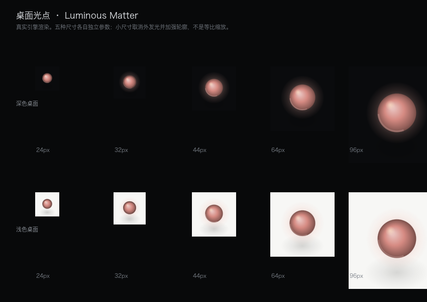
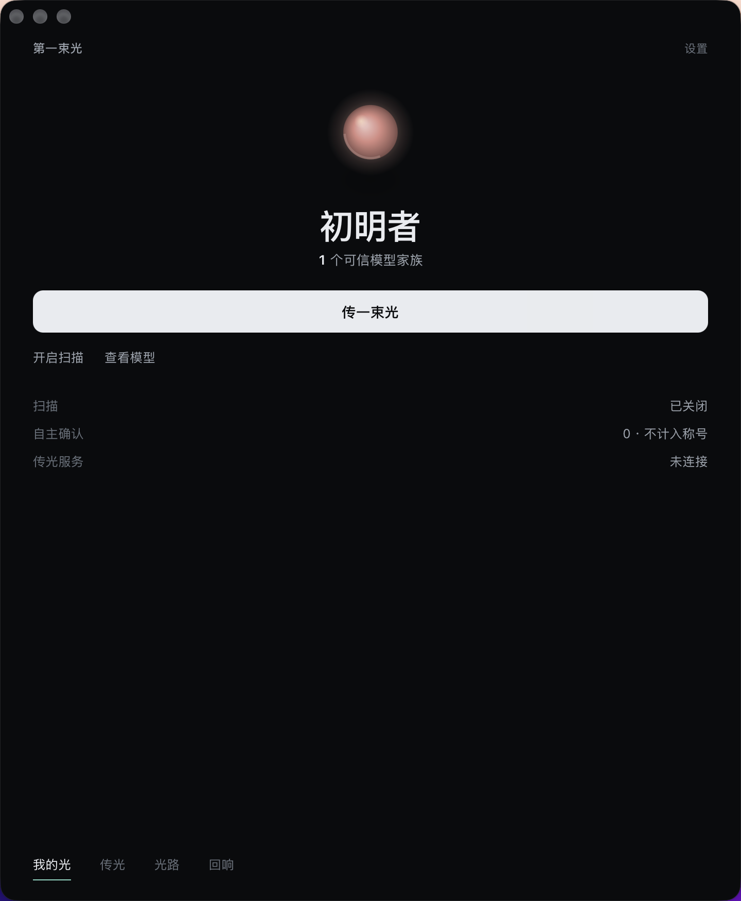

# F3.7｜Silent Future 重构报告

方向：A（Silent Future 结构）+ B（Luminous Matter 光点）。C 未采用。
业务代码未改：RootIdentity / E3-E4 / 状态机 / 扫描授权 / Keychain / 服务端 / SSE 全部原样。

## 1. 设计系统（R0）

`packages/visual-system/tokens.json` → **3.0.0**。`levels` 五键保留（Rust 调色板测试绑定它），
其余全部重写。回滚：`git revert` 到 2.0.0，UI 与之同 commit 回退。

| 组 | 内容 |
|---|---|
| 色（深） | page `#0A0B0D` / surface `#111316` / raised `#171A1E` / border `#FFFFFF14` |
| 色（浅） | page `#F7F7F5` / surface `#FFF` / border `#00000012` |
| 文字 | `#E8EBEF` / `#9BA3AD` / `#666E78` 三级 |
| 信号 | `#7ED6C0`（仅用于已核验/已激活），暖 `#E8A87C`，危险 `#E0686A`，警告 `#D6A86A` |
| 字 | 系统 UI 字体；34 / 22 / 15 / 13 / 11.5 / 10 |
| 间距 | 4 / 8 / 12 / 16 / 24 / 32 / 48 / 64；hairline 1px；icon 描边 1.5px |
| 栅格 | 边距 32，内容宽 560，12 栏，栏距 16 |
| 动效 | 120ms 微交互 / 200ms 状态 / 240ms 换页；呼吸 6.4s，幅度 3.5%，只作用于雾层 |

灰度检查：全部层级由字号、字重、明度差建立，信号色只做"是否已核验"的二值提示，去掉颜色后仍可读。

## 2. 光点（R0，本轮重点）

引擎重写为 `paintBead`：**体块（limb darkening）→ 边缘反光 → 单点高光 → 接触阴影 → 小范围外晕**。

| 尺寸 | 体直径 | 外晕 | 策略 |
|---|---|---|---|
| 24 | 10 | 无 | 取消外晕，加 1px 暗边，靠轮廓与阴影辨识 |
| 32 | 13 | 0.34r | 同上，开始出现极轻光感 |
| 44 | 17 | 0.36r | 桌面默认 |
| 64 | 24 | 0.34r | — |
| 96 | 34 | 0.32r | — |

**没有缩放复用**：每个尺寸独立参数，小尺寸不是大尺寸的缩略图。

**不裁切**：外晕半径 `min(veil, size/2 - 0.5)`，渐变在画布边界前收敛，四角恒为透明。

**浅底成立的原因**：接触阴影是遮挡而非发光。加色光在白底上无法存在，遮挡可以。

## 3. 四页（R1/R2）

- **我的光**：光点 → 称号 → 家族数 → 一个主操作「传一束光」；扫描状态降为底部次级行。
- **传光**：二维码白底块保证静区与对比；RECEIVED / LEARNING / ACTIVATED 用三句不同文案。
- **光路**：三个数字 + 分隔线列表，无轨道、无断线、无装饰占位。
- **回响**：保留极简，统一字体，未增加内容。

其余三页截图：`page-give.png`、`page-paths.png`、`page-echo.png`。

## 4. 回归与性能

| 套件 | 数量 | 本轮 |
|---|---|---|
| Rust | 193 | 重跑，全绿 |
| 协议一致性 | 12 | 重跑，全绿 |
| 服务端 | 29 | 未重跑（`services/api` 未改动） |
| F2 桌面 E2E | 10 | 未重跑 |
| F3.5 传光 E2E | 14 | 未重跑 |

| 指标 | F3.6-R3 | **F3.7** |
|---|---|---|
| 空闲 CPU | 0.021% | **0.039%** |
| 安静模式 | 0.021% | **0.015%** |
| RSS | 113.0 MB | **113.1 MB** |
| 20s 增长 | 0.0 | **-0.1 MB** |
| 残留进程 | 无 | 无 |

空闲 CPU 略升 0.018 个百分点：光点从"两张静态位图"变成"一张位图 + 呼吸合成"，
仍在目标（<1%）内两个数量级以下。

## 5. 未完成 / 未验证

| 项 | 状态 |
|---|---|
| 我的光纵向平衡 | **仍有空洞**：上下弹性占位已加，但截图显示内容仍偏上，需再调一轮 |
| 尺寸研究图 96px 列溢出 | 已知缺陷，图版问题非产品问题 |
| 呼吸/回响录屏 | **未录制** |
| 用户可用性测试 | **USER_STUDY_PENDING**，无真实参与者，不伪造 |
| F2 / F3.5 E2E 本轮重跑 | **未做**，改动仅 UI 层，但属判断非证据 |
| 非激活窗口真实首击 | **仍 PENDING**（本次只改了手势上限，未获 OS 级验证） |
| Keychain 成功路径 | **仍 PENDING** |
| Impeccable 接入 | **未安装**；安装器会写入仓库根，超出本轮授权范围 |

两个 PENDING 项**没有**因 UI 重构被升级为通过。
