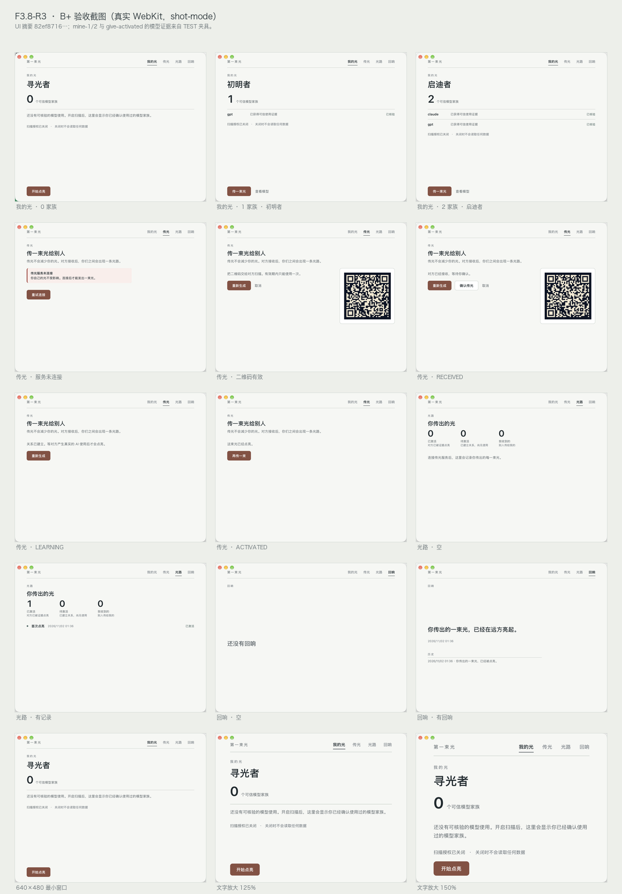

# F3.8-R3｜最终集成与视觉验收包

UI 摘要（build.rs 计算的内容哈希）：`82ef87165d16…`
本轮未改 B+ 的字体、布局、配色、光点，未加功能。

---

## 1. 全量回归（全部本轮重跑）

| 套件 | 结果 |
|---|---|
| Rust 单元 + 集成 | **193 全绿** |
| TypeScript 协议 | **12 全绿** |
| 服务端 | **29 全绿** |
| F2 桌面 E2E | **10/10** |
| F3.5 传光 E2E | **14/14** |
| 扫描授权负向 | **5/5**（拒绝时读取计数 0） |
| UI 契约 / 资源 / 选择器 | **19/19** |

F3.5 E2E 实测关键行：
`A12 激活 → {"kind":"FIRST_LIGHT","state":"ACTIVATED"}`；`A13 SSE 回响 phase=acknowledged`；
`A14 重放 already_activated:true，计数仍为 1`；`A15 光路 state=ACTIVATED echoes=1`。

**两处测试契约在本轮被修正**（不是产品缺陷，是测试模型过期）：

1. `f2_e2e.py` 读 `haloRadius`，但光点自 F3.7 起已改为 bead，探针字段是 `beadPx`。
2. `f2_e2e.py` 用例 C 派发 legacy `mouseup`，而浮层自 F3.7 起监听 pointer 事件。
   真实鼠标会同时产生 pointer 与 mouse 事件，所以产品行为正确，是测试没模拟对。
   已改为派发 `PointerEvent`。

---

## 2. 截图（15 张，全部真实 WebKit，`shot-mode` 调试激活模式）



| 文件 | 状态 | 数据来源 |
|---|---|---|
| `mine-0.png` | 寻光者 · 0 家族 | 真实（未扫描） |
| `mine-1.png` | 初明者 · 1 家族 · gpt | **TEST 夹具** |
| `mine-2.png` | 启迪者 · 2 家族 · claude/gpt | **TEST 夹具** |
| `give-offline.png` | 服务未连接 | 真实 |
| `give-waiting.png` | 二维码有效 | 真实服务端 |
| `give-received.png` | RECEIVED | 真实服务端 |
| `give-learning.png` | LEARNING | 真实服务端 |
| `give-activated.png` | ACTIVATED | 真实服务端 + **TEST E3** |
| `paths-empty.png` / `paths-data.png` | 光路 空 / 1 条已激活 | 真实 |
| `echo-empty.png` / `echo-data.png` | 回响 空 / 有回响 | 真实 |
| `size-640x480.png` | 最小窗口 | 真实 |
| `zoom-125.png` / `zoom-150.png` | 文字放大 | 真实（body zoom） |

**没有暴露**：邀请凭据（二维码仅在 waiting/received 短窗内存在，且未显示 token 文本）、
恢复码、私钥。所有截图来自运行中的应用，无设计稿。

三态是同一台机器两个实例 + 一个真实本地服务端跑出来的完整序列
`OFFERED → RECEIVED → LEARNING → ACTIVATED → 回响`。

---

## 3. 模型展示一致性

| 场景 | 结果 |
|---|---|
| 0 家族 | 寻光者 / 0 / 无行 / 主操作「开始点亮」 |
| 1 家族 | 初明者 / 1 / `gpt` 已核验 |
| 2 家族 | 启迪者 / 2 / `claude`、`gpt` 已核验 |
| DOM 文本 | `renderedText: ['claude','gpt']`，无 `undefined`/`null`/`NaN`/`[object Object]` |

`families_contract.test.mjs` 的 H 项直接读 `scan.rs`，断言 `FamilyView` 没有 `name` 字段，
这类字段漂移不会再静默通过。

---

## 4. UI 构建一致性（本轮修复的真实缺陷）

**原实现的问题**：`rerun-if-changed=../ui` 指向**目录**，cargo 只监听目录项增删，
**不监听已有文件的内容变化**——所以改了 HTML 内容不会重编。这正是 R1 里"改了两次还是旧界面"的机制。

**修复**：

- `build.rs` 递归枚举 `ui/` 下每个文件，逐个 `rerun-if-changed`
- 同时对**将被嵌入的文件集合**计算 SHA-256 内容摘要，写入 `target/ui-hash.txt`
  并通过 `cargo:rustc-env=FL_UI_HASH` 注入二进制
- 新增 `ui_build_hash` 命令，面板 `__panelProbe.uiHash` 返回它
- `ui_resource.test.mjs` 用同样算法重算源码摘要，与 `target/ui-hash.txt` 比对

**实测**：

```
source digest: 82ef87165d16dea47a768aa462bca020b531c7d03fa4b83e55d979c2b9837fa0
build  digest: 82ef87165d16dea47a768aa462bca020b531c7d03fa4b83e55d979c2b9837fa0
MATCH
运行中 uiHash: 82ef87165d16…
```

不再依赖人工更新版本字符串，也不再用 `touch main.rs`。

---

## 5. 性能（测量前已确认无并发实例）

| 指标 | 值 |
|---|---|
| 空闲 CPU | **0.013%** 均值 / 0.022% 峰值 |
| 安静模式 CPU | **0.004%** 均值 / 0.009% 峰值 |
| RSS | **112.0 MB**，20s 增长 **0.0 MB** |
| 残留进程 | 无 |

---

## 6. 无障碍与窗口适配

| 检查 | 结果 |
|---|---|
| 正文对比度 | 13.47 / 5.23 / 4.70，均 ≥4.5 |
| 按钮白字 | 6.41 |
| 已核验语义色 | 5.78 |
| 分隔线（非文本） | 1.48 ≥1.4 |
| 焦点可见 | `:focus-visible` 2px 赤陶描边 |
| 按钮命中区 | 高 36px，宽按文字 + 36px 内边距 |
| 640×480 | 内容完整，无裁切（见 `size-640x480.png`） |
| 文字放大 125% / 150% | 无裁切、无横向滚动（见 zoom 图） |
| 无效文本 | 自动化断言为 0 |

未做：系统级字号缩放（改的是页面 zoom）、屏幕阅读器实读、色盲模拟。

---

## 7. 仍未验证 / BLOCKED

| 项 | 状态 |
|---|---|
| 扫描权限被拒绝的专属截图 | **未拍**——当前「我的光」不展示拒绝原因，只显示「扫描授权已关闭」。这是真实的 UI 缺口，未修 |
| E3 真实来源 | **非真机验证**：本轮 E3 来自夹具，只证明集成流程 |
| 非激活窗口 OS 真实首击 | **PENDING** |
| Keychain 成功路径 | **PENDING** |
| 真人可用性测试 | **USER_STUDY_PENDING** |
| Windows / 移动端 | **BLOCKED**（无环境） |

三个 PENDING 项未因本轮升级——所有截图来自 `shot-mode` 调试激活模式，
**不能作为非激活窗口交互的验收证据**。

---

## 8. 修改文件

`apps/desktop/src-tauri/build.rs`（逐文件依赖 + 内容摘要）
`apps/desktop/src-tauri/src/main.rs`（`ui_build_hash` 命令）
`apps/desktop/ui/panel.html`（探针暴露 `uiHash`）
`apps/desktop/tests/ui_resource.test.mjs`（摘要校验）
`apps/desktop/tests/f2_e2e.py`（探针字段 + pointer 事件）
