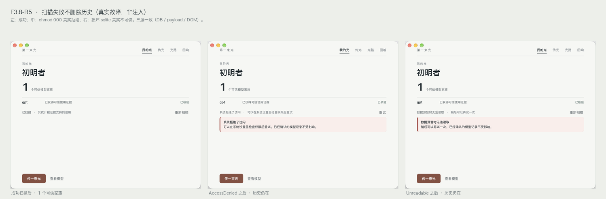

# F3.8-R5｜扫描失败状态与历史保护验收

本轮只补两个缺口：两种失败分支的真实验证，以及"失败不删除历史"的端到端证明。

---

## P0-1 · 两个失败分支（真实故障，非注入）

### 故障来源

两种都是**真实故障**，没有修改用户数据、没有改系统安全设置：

| 分支 | 制造方式 | 适配器真实报错 |
|---|---|---|
| AccessDenied | 把测试夹具目录下所有文件 `chmod 000` | `local database could not be opened read-only: cannot open database` |
| Unreadable | 用正确文件名写入垃圾内容 `state_1.sqlite` | `local database could not be opened read-only: database cannot be read` |

### 传播路径

```
adapter I/O 失败
  → scan::run 捕获，原始错误只写 stderr（含路径/异常，不进 UI）
  → classify_read_error(msg)  →  ScanStatus::AccessDenied | Unreadable
  → ScanOutcome.simple(status, 固定短句)
  → light_payload.scan.status
  → panel scanState() → 文案 + 下一步 + 提示条
```

`classify_read_error` 是纯函数，三种结局各自有独立断言：

- `read_errors_classify_into_the_right_status`：5 条 AccessDenied 样本、5 条 Unreadable 样本
- `a_read_failure_is_never_reported_as_client_not_found`：两种失败都 **≠** ClientNotFound

实测：

```
denied  → access_denied | 系统拒绝了访问本机数据。可以在系统设置中检查权限后重试。
corrupt → unreadable    | 数据源暂时无法读取。稍后可以再试一次。
```

**证据性质**：REAL FAILURE / REAL UI RENDER（真实权限故障 + 真实损坏文件），
不是 INJECTED FAILURE。截图见 `history-after-denied.png` / `history-after-unreadable.png`。

### 一处必须说明的耦合
适配器把 sqlite 错误码压成了两句话（`cannot open database` / `database cannot be read`），
分类依据就是这两句。这是**字符串耦合**：如果适配器改措辞，上面的单测会失败并提示同步修改。
更强的做法是让适配器返回带错误码的类型化错误，但那会改到 adapter 的公共接口，超出本轮范围。

---

## P0-2 · 失败不删除历史（13 步端到端）



| # | 步骤 | 结果 |
|---|---|---|
| 1 | 授权扫描（夹具 gpt） | `ok` |
| 2 | payload | **1 / 初明者 / ['gpt']** |
| 3 | 本地数据库 | **1 行 / ['gpt']** |
| 4 | chmod 000 → 扫描 | `access_denied` |
| 5 | payload | **1 / 初明者 / scan=系统拒绝了访问** |
| 6 | 数据库 | **1 行 / ['gpt']** |
| 7 | **重启应用** | **1 / 初明者 / ['gpt']** |
| 8 | 损坏 sqlite → 扫描 | `unreadable` |
| 9 | payload | **1 / 初明者 / scan=数据源暂时无法读取** |
| 10 | 数据库 | **1 行 / ['gpt']** |
| 11 | 恢复数据源 → 扫描 | `ok` |
| 12 | 数据库 | **1 行**（无重复计数） |
| 13 | payload | 1 / 初明者 |

原始日志：`history-e2e.json`。

### 本轮修掉的第二个真实缺陷
第一次跑这个实验时，计数保住了但**称号从「初明者」掉回「寻光者」**——
`knowledge_title` 仍取自最近一次快照，失败时快照为空。
现在两者都从"库里已核验的家族数"派生，所以同一份事实在任何扫描状态下显示一致。

---

## 历史回退的可信边界

- 回退只读 `countable_evidence` 表（既有 E3/E4 规则写入的记录），不读发现态、不读 E2。
- 扫描失败不会写入新证据，也不会升级称号——回退只做展示，不做推断。
- 从未成功扫描过时，库里没有记录，回退结果为空，界面显示 0 —— 不会凭空出现历史。

---

## 权限安全回归

| 检查 | 结果 |
|---|---|
| 扫描关闭时读取次数 | **0**（f3_6_scan_auth） |
| 本次未确认时读取次数 | **0** |
| 撤销授权后下一次扫描 | **0** |
| `complete_transfer` 触发扫描 | **0**（用独立计数器验证） |
| 失败日志是否含路径/正文 | 不含（只进 stderr，UI 用固定短句） |
| 失败是否写入新证据 | 不写（步骤 6/10 数据库行数不变） |

---

## 完整回归（本轮全部重跑）

| 套件 | 结果 |
|---|---|
| Rust | **195 全绿**（新增 2 项分类测试） |
| TypeScript 协议 | **12 全绿** |
| 服务端 | **29 全绿** |
| F2 桌面 E2E | **10/10**（首次因残留实例超时，清理后重跑通过） |
| F3.5 传光 E2E | **14/14** |
| 扫描授权负向 | **5/5** |
| UI 契约 / 资源 / 选择器 | **19/19** |

---

## 修改文件

| 文件 | 改动 |
|---|---|
| `apps/desktop/src-tauri/src/scan.rs` | `classify_read_error` 纯函数；`AccessDenied`/`Unreadable` 分类；两条分类测试；计数器测试加锁 |
| `apps/desktop/src-tauri/src/main.rs` | 家族数与**称号**都回退到库里已核验记录；`get_settings` 暴露扫描状态 |
| `apps/desktop/ui/panel.html` | 七态映射、提示条、内联操作、探针暴露 scan 文本 |

---

## 仍未验证

| 项 | 状态 |
|---|---|
| OS 层自然发生的真实拒绝（未改权限） | **未获得**：本轮 AccessDenied 是真实 `chmod 000` 造成的真实 EACCES，但仍是自造条件 |
| 非激活窗口 OS 首次点击 | **PENDING** |
| Keychain 成功路径 | **PENDING** |
| 真人可用性测试 | **USER_STUDY_PENDING** |
| 真实非夹具 E3 跨设备 | **PENDING** |
| Windows / 移动端 | **BLOCKED** |

## 结论

两个缺口都补齐了：两种失败分支各自独立可复现、有截图、有三层一致断言；
失败不删除历史有 13 步端到端证据，且顺带修掉了"称号回退"这个我第一轮漏掉的缺陷。

不自行宣布 VISUAL VERIFIED，不进入 F4。
