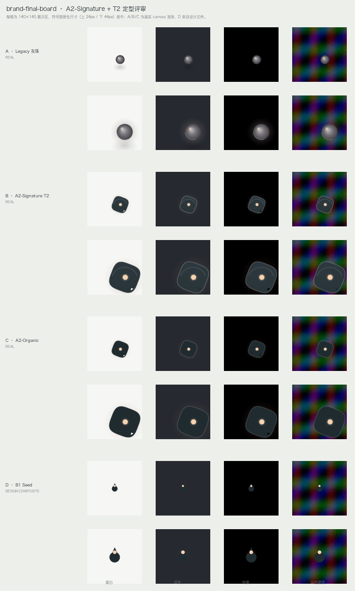

# F3.9 品牌视觉评审包 · A2-Signature + T2

**冻结状态**：几何与材质已冻结，本轮未做任何参数探索。
**未合并生产**：分支 `f39r2-aperture-experiment`；默认渲染器仍是 `paintBead`（回滚 = 不设
`FIRSTLIGHT_LIGHT_STYLE`）。

---

## 1. 最终几何与材质参数

```
主体      超级椭圆 |x|^n+|y|^n=1，n=3.45，旋转 15°（signature 再 +6°）
半径      R = 0.355 × 边长
孔径      玫瑰线 r(θ)=r0·(1+0.045·cos6θ)
          r0 = R·(0.13 + 0.50·tier)，tier 由 verified_families 派生
缺口      基础角宽 6.5°，小尺寸自动加宽至恒定 ≥2.6 CSS px；深度 0.88R；方位 38°
细缝      默认关闭（seamsMinSize=9999）
材质 T2   body #2C383D，顶光渐变 0.18，内反射弧 0.45，rim α 0.12，
          暖光 1.05，接触阴影 0.12
轮廓补偿  1px 浅色描边，alpha 8%（经 none/8/16/24 对照选定）
渲染      单次烘焙，安静模式 draw=0 / rAF=0
```

## 2. 评审板



四方案 · 同尺寸（24/44px）· 同底色（暖白 / 深灰 / 纯黑 / 深色合成壁纸）。
A/B/C 为真实 WebKit canvas 渲染；**D 为设计文件合成，不是 App 截图**。

## 3. 原始尺寸文件（未放大替代）

`assets/a2-24.png` `a2-44.png` `a2-96.png` — 原生像素。
`assets/desktop-24.png` `desktop-44.png` `desktop-96.png` — 真实桌面窗口裁切（132×132 窗口）。
`assets/desktop-24-pixels.png` — 最近邻放大，用于看清真实像素。

## 4. 应用图标

`icon-512.png` / `icon-1024.png`：圆角矩形底板（半径 22.37%）+ 居中 62% 符号，
符号来自真实 512/1024 渲染，非放大。

## 5. 光学校正前后

`assets/notch-24-on.png` / `notch-24-off.png`（同状态、仅缺开关差异）
`assets/notch-24-zoom.png`（8× 最近邻）
`assets/notch-measure.json`：16px 8 像素、24px **11 像素**、44px 25、96px 92。

## 6. B+ 页面真实运行

`assets/page-44-t2.png`：720×560 真实窗口，44px 符号与「初明者 / 1 个可信模型家族」同排。

## 7. 材质对照

`assets/material-board.png`：base / T1 / T2 / T3 × 六底色 × 24/44px。

## 8. 性能与已知限制

| | 实测 |
|---|---|
| 动效 CPU | 0.066%（base 0.054%） |
| 安静 CPU | 0.023%（base 0.014%） |
| RSS | 113.6 MB |
| 烘焙次数 | 1 |
| 残留进程 | 0 |

已知限制：
- **深底**：T2 让主体在深底可见，但内反射会形成一圈"壳"的轮廓，观感偏"器件"。
- **24px**：缺口 11 像素的变化确实可见，但**这不等于真人能认出来**。
- **方形主体**在极简背景下仍可能被读成"按钮/方块"。

## 9. 连续动效未验证

**RECORDING_BLOCKED**：本机未授予屏幕录制权限，且我没有尝试绕过。
现有材料只有逐帧真实截图，**不能作为连续实时动画的验收证据**。
`f39_r3/recording-breathing.gif` 是逐帧拼接，不是录屏。

## 10. 保留的设计风险

1. **仍具相机光圈联想** —— 六瓣结构天然接近，缺口只削弱了机械感，没有脱离这个大类。
2. **方形主体可能被读成按钮**。
3. **像素变化 ≠ 识别成功**：24px 多出 11 个像素是测量事实，不是可用性结论。
4. **USER_STUDY_PENDING**：无真人识别测试，未做遮蔽名称的快速访谈。
5. **RECORDING_BLOCKED**：见上。
6. **B1 未在引擎中实现**，其对照图是设计合成。
7. **大尺寸图标未在 Dock/Finder 中实装验证**。

## 11. 文件清单

```
brand-final-board.png        四方案定型评审板
icon-512.png icon-1024.png   应用图标
assets/a2-*.png              真实渲染（24/44/96/512/1024）
assets/legacy-*.png          旧灰珠对照
assets/b1-*.png              B1 设计合成
assets/desktop-*.png         真实桌面
assets/page-44-t2.png        B+ 页面
assets/notch-*               缺口校正证据
assets/material-board.png    材质对照
```
