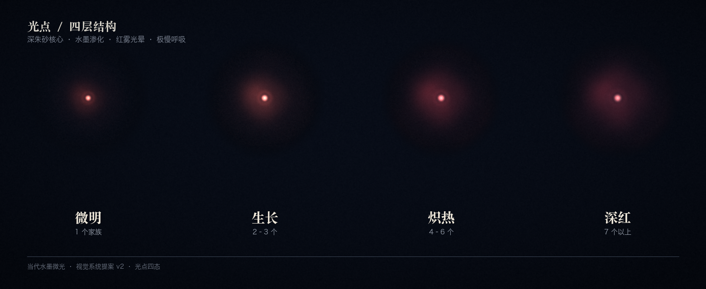
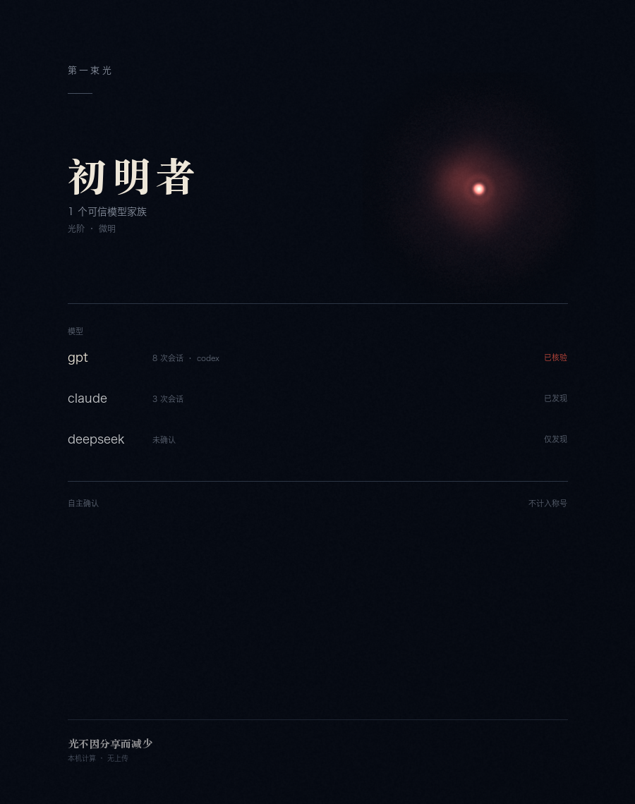
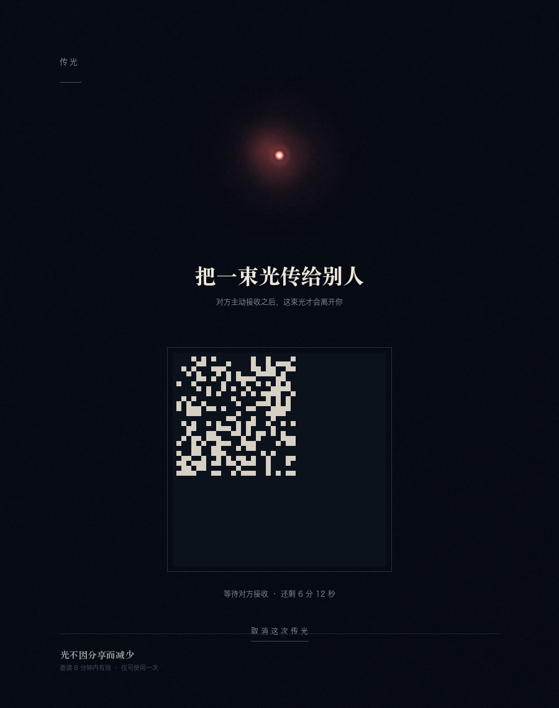

# 当代水墨微光 · 视觉系统提案 v2

> 目标不是"更好看一点"，而是让第一束光从工具界面变成一件有气质的数字作品。
> **本文件只是提案。迄今没有改动任何产品代码。**

配图（本轮渲染的真实像素，非示意）：
- [光点四态](visual/light-study.png)
- [光点四层细节](visual/light-detail.png)
- [我的光 · 版式](visual/page-my-light.png)
- [传光 · 版式](visual/page-transfer.png)

---

## 0. 三个设计判断（先说立场）

### 0.1 为什么放弃现在的方案
现在的光点是「深色面板 + radial glow 红点 + 卡片列表」。它的三个问题：

| 问题 | 表现 |
|---|---|
| 光点像 LED | 纯径向渐变 + `lighter` 叠加，边缘数学完美，像屏幕上的一个像素灯 |
| 面板像后台 | 卡片、行、徽标 pill、按钮框——每一处都在说"这是设置界面" |
| 缺少留白 | 信息密度向"尽量多显示"妥协，没有呼吸 |

### 0.2 为什么是水墨，但不是纯水彩
纯水彩太柔、太散、容易滑向插画疗愈产品；纯水墨又太干、太冷、撑不起"光"。

**水墨负责结构，水彩负责湿润。**
- 结构：边缘的**渗化**（不是模糊）、**水线**（边缘积色）、**留白**（不画的地方比画的地方重要）
- 湿润：红雾光晕要有**湿中湿**的透明层次，像一滴朱砂落在湿纸上

### 0.3 一个必须承认的物理矛盾
桌面光点是**透明浮层**，"纸"是用户的壁纸。水墨是减色的（比纸更暗），光是加色的（比底更亮）。
两者在同一像素上冲突。

**解法（本提案的核心取舍）**：
- **光**永远用加色混合——在任何壁纸上都成立。
- **墨**用极低透明度的正片叠底——在浅色壁纸上是"洇开的墨"，在深色壁纸几乎消失。
- 结果：**浅底见墨，深底见光。** 这不是妥协，这是墨与纸的真实关系，恰好也是两种桌面下的两种气质。

面板是不透明窗口，纸由我们提供，四层全部成立。

---

## 1. 配色系统

### 1.1 墨（结构色）

| 名 | HEX | 用途 | 用量 |
|---|---|---|---|
| 墨黑 | `#070B14` | 面板底、桌面层最深 | 主体 |
| 墨蓝 | `#0A1018` | 卡片/纸面基底 | 大面 |
| 淡墨 | `#101828` | 抬升面（极少用） | 少 |
| 水线 | `#1A2333` | 分割线、边缘积色 | 线 |

### 1.2 白（信息色）

| 名 | HEX | 用途 |
|---|---|---|
| 象牙白 | `#EDE6D8` | 主标题、关键数字（**永不使用纯白 #FFF**） |
| 雾白 | `#D6D2C8` | 正文 |
| 淡雾 | `#8A929F` | 次要说明 |
| 极淡 | `#5C6472` | 标签、页码 |
| 线灰 | `#3A4250` | hairline（1px 以下观感） |

### 1.3 红（光色，朱砂体系）

| 名 | HEX | 光阶 | 说明 |
|---|---|---|---|
| 朱砂 | `#AC372C` | 微明 | 传统朱砂，偏赤褐，不刺眼 |
| 绯红 | `#C4483C` | 生长 | 一点点向暖 |
| 胭脂 | `#92282C` | 炽热 | 更沉、更艳 |
| 绛 | `#681B22` | 深红 | 最深，接近凝血 |
| 灯火 | `#FFD2BC` | 核心高光 | 只在核心中心 3px 内出现 |

**比例纪律**：任何一屏，墨 ≥ 88%，白 ≤ 10%，红 ≤ 2%。红色一旦超过 2%，就不再是"微光"。

### 1.4 不可用色
纯黑 `#000`、纯白 `#FFF`、任何高饱和青/紫/绿、任何渐变彩虹、任何发光描边。

---

## 2. 材质语言

| 材质 | 规则 | 禁止 |
|---|---|---|
| **宣纸** | 面板底加 3% 高斯噪声 + 极慢斜向明暗（像窗光落在墙上）；只在面板出现，桌面层透明不加 | 纹理贴图、纸张照片、折痕滤镜 |
| **墨** | 由多笔叠出，边缘**渗化**：先浓后淡，边缘比中心略深（水线）；单次落笔不超过 3 层 | 纯径向渐变、均匀模糊、外发光描边 |
| **水彩** | 湿中湿：两到三层不同半径、不同透明度、不同相位的晕染叠加；必须有**斑驳**（大尺度密度不均） | 单一 alpha、均匀圆、任何"光晕预设" |
| **留白** | 一屏至少 45% 是空的；标题周围留 96px；卡片之间不用间距，用**分隔线 + 留白** | 用卡片填满、用图标占位 |
| **线** | 只用 1px、透明度 8–14% 的 hairline；可分主副两级 | 0.5px 以下、彩色线、虚线框、圆角边框 |

---

## 3. 光点重设计（四层）



### 3.1 结构（从内到外，从后到前）

| 层 | 名称 | 混合 | 作用 |
|---|---|---|---|
| L1 | **深朱砂核心** | 加色 | 5–7px，朱砂饱和；中心 1.5px 有灯火色高光；边缘不规则 |
| L2 | **水墨渗化层** | 正片叠底（很淡） | 核心外 1.6–2.4 倍，墨蓝；像朱砂落地时把纸洇湿的一圈 |
| L3 | **轻薄红雾光晕** | 加色 | 6–9 倍，透明度 0.18–0.30；带斑驳，边缘有极淡水线 |
| L4 | **极慢呼吸** | 调制 | 12–16 秒一个周期，振幅 6–8%；**只调制雾与墨，核心几乎不呼吸** |

**关键细节：核心不呼吸，雾才呼吸。**
现在的问题是整个 alpha 一起变，看起来像 LED 调光。真实的光是"光核稳定，周围空气会动"。

### 3.2 四态参数

| 光阶 | 核心色 | 核心半径 | 墨半径 | 雾半径 | 雾透明度 | 呼吸周期 |
|---|---|---|---|---|---|---|
| 微明 | 朱砂 `#AC372C` | 5.2 | 13 | 34 | 0.30 | 15 s |
| 生长 | 绯红 `#C4483C` | 5.8 | 17 | 44 | 0.36 | 13 s |
| 炽热 | 胭脂 `#92282C` | 6.4 | 22 | 54 | 0.42 | 12 s |
| 深红 | 绛 `#681B22` | 7.0 | 28 | 64 | 0.48 | 12 s |

（单位：逻辑像素，窗口 132×132；细节见 [light-detail.png](visual/light-detail.png)）

### 3.3 边缘
每层用 3–5 个低频谐波做角度扰动，扰动幅度随层级递减（核心 12%，雾 26%）。
**扰动是静态的**（每个光阶固定一组种子），不做边缘蠕动——蠕动会立刻变成"熔岩灯"。

### 3.4 呼吸
```
radius(t) = R * (1 + 0.045 * sin(2πt/T))
alpha(t)  = A * (1 + 0.10 * sin(2πt/T + φ))   φ = 0.4rad
```
雾与墨的相位略有偏移（φ≠0），会产生极轻微的"空气流动"感。

### 3.5 桌面透明层的特别约束
- 墨层在深色壁纸下几乎不可见 → 这是**设计意图**（深底见光）。
- 光层必须保证在纯白壁纸下也不刺眼：加色叠加在白色上会迅速饱和，
  因此雾的 alpha 上限固定 0.30，核心半径不超过 7px。
- 提供"浅色壁纸模式"：把墨层 alpha 提高 1.6 倍、雾降低 0.7 倍（用户可在设置里选，或按壁纸亮度自动）。

---

## 4. 四个页面

### 4.0 共同结构（不是卡片，是版面）

```
┌──────────────────────────────────────────┐
│  96px 左边距                              │
│  页眉：栏目标（10px 字距 3.2）  ← hairline │
│                                          │
│  主内容：单一纵向流，最大宽 560            │
│  光：放在页面的"空"里，不放在内容里        │
│                                          │
│  ─────────── hairline ───────────        │
│  页脚：一句宣言（宋体 15px）+ 一句事实（10px）│
└──────────────────────────────────────────┘
```

- **导航空间**：不用侧边栏、不用 Tab。用页面底部的三个词（我的光 / 传光 / 光路），
  当前项用一条 24px 的 hairline 标示。切页时是**淡入 + 位移 8px**，不是滑动。
- 面板尺寸 900×1140（比现在的 430×620 更大，给留白用）；小屏可降到 720×960。

### 4.1 我的光



| 区 | 内容 | 规格 |
|---|---|---|
| 页眉 | 第一束光 | 10px / 字距 3.2 / 淡雾 |
| 称号 | 初明者 | 宋体 56px / 象牙白 / 字距 6 |
| 副行 | N 个可信模型家族 · 光阶 | 14px / 雾白、12px / 极淡 |
| 光 | 置于右上留白 | 330px 画布，光阶当前色 |
| 分隔 | hairline 全宽 | 线灰 8% |
| 模型列表 | 家族名 / 会话数 / 证据等级 | 17px / 11px / 11px，行高 58，无边框 |
| 自主确认 | 单独一行，右侧标"不计入称号" | 极淡 |
| 页脚 | 「光不因分享而减少」+ 本机计算 | 宋体 15 / 10px |

**证据等级不用 pill**，用文字颜色区分：已核验=朱砂，已发现=极淡，仅发现=更淡。

### 4.2 传光



| 区 | 规格 |
|---|---|
| 光 | 居中偏上，260px —— 这一页光是主角 |
| 标题 | 「把一束光传给别人」宋体 34px，居中 |
| 副行 | 「对方主动接收之后，这束光才会离开你」12px 雾白 |
| 邀请 | 360×360 纸块，1px 线灰描边，二维码满块（象牙白模块、墨底） |
| 状态 | 一行文字 + 倒计时，12px 雾白，**无进度条** |
| 动作 | 「取消这次传光」纯文字 + hairline 下划线，居中 |

没有按钮框、没有"主按钮/次按钮"的视觉层级。只有一个可以点的地方。

### 4.3 光路

不是表格，是**垂直墨线时间轴**：

```
│
●  首次点亮 · 8/12 14:30          ← 实心朱砂点 = 已激活
│
○  等待真实使用 · 8/12 09:10       ← 空心点 = 进行中
│
●  首次点亮 · 7/30 21:04
│
```

- 竖线：1px，透明度 10%，贯穿全高
- 节点：5px 圆点；已激活=朱砂实心 + 极淡红雾，进行中=空心 1px 朱砂
- 每条右侧只有两行：类型 + 时间；不显示对方身份（对方是匿名的）
- 顶部三个数字用**大号数字 + 小字标签**，不并列成三个卡片：
  ```
  1        2        0
  已点亮    等待中    我收到的
  ```

### 4.4 回响

最空的一页。这是刻意的。

| 状态 | 呈现 |
|---|---|
| 有回响 | 居中一行：「你传出的一束光，今天又亮了。」宋体 24px；背后一圈极淡、缓慢扩散的水墨环 |
| 无回响 | 居中一行：「还没有回响。」12px 极淡；下方一行更小的提示「对方真正开始使用 AI 之后，这里会亮一次」 |
| 历史 | 底部极小的日期列表（10px），不是列表卡片 |

回响页**不显示**接收者的任何信息——只有一句话、一个时间。

---

## 5. 动效原则

### 5.1 动词表（只能用这些）

| 动词 | 实现 | 时长 |
|---|---|---|
| 渗 | 边缘从内向外逐渐显现（mask 扩散） | 1200–2200 ms |
| 呼 | 半径与透明度的正弦调制 | 12000–16000 ms |
| 散 | 环向外扩散并同时变淡 | 2600–4200 ms |
| 沉 | 透明度下降到 40% 并保持 | 700 ms |
| 起 | 8px 位移 + 透明度 0→1 | 600 ms |

### 5.2 缓动
```
--ease-ink-bleed:  cubic-bezier(.16, 1, .30, 1);    /* 渗：快起慢收 */
--ease-ink-settle: cubic-bezier(.22, .61, .36, 1);  /* 沉/落 */
```

### 5.3 禁止清单
- ❌ 任何 spinner / 骨架屏 / 进度条
- ❌ 霓虹外发光、扫描线、网格背景
- ❌ 弹簧回弹、bounce、overshoot
- ❌ 任何 < 300ms 的过渡（那是"UI"，不是"气韵"）
- ❌ 同时动三个以上元素
- ❌ 鼠标悬停时元素放大

### 5.4 仪式（传光全过程）
| 阶段 | 视觉 | 驱动 |
|---|---|---|
| 发起 | 核心一次极轻的脉动（不是闪光） | 服务端 OFFERED |
| 等待 | 雾外侧出现一圈极淡、极慢旋转的水线（τ≈42s） | 轮询状态 |
| 双方确认 | 从核心析出一粒 2.6px 的墨点，沿弧线离开，身后带 5 个逐渐变淡的残影 | LEARNING |
| 对方收到 | 外环一圈水墨扩散 | RECEIVED |
| 真实使用 | 核心颜色转变（1.8s 渗变）+ 帮助者收到一圈回响 | ACTIVATED / 回响 |

**动画永远不改变业务状态**（沿用 F3.5 的硬规则）。

---

## 6. Figma 级结构说明

### 6.1 画板
| Frame | 尺寸 | 说明 |
|---|---|---|
| `Panel / MyLight` | 900×1140 | 主界面 |
| `Panel / Transfer` | 900×1140 | 传光 |
| `Panel / Path` | 900×1140 | 光路 |
| `Panel / Echo` | 900×1140 | 回响 |
| `Light / Point` | 132×132 | 桌面光点（透明） |
| `Study / Light ×4` | 1560×640 | 光点四态研究板 |

### 6.2 栅格
- 外边距 96 / 内容最大宽 560 / 12 栏 / 栏距 32
- 纵向节奏：8 的倍数，但**只用** 8 / 12 / 20 / 32 / 52 / 84（非等比，制造呼吸）
- 基线网格 4px

### 6.3 图层命名
```
Panel / MyLight
├─ bg / paper                      (纸 + 噪点，锁定)
├─ light / point                   (四层，见 6.4)
├─ header / eyebrow
├─ title / knowledge
├─ meta / families
├─ rule / divider
├─ list / families
│  ├─ row / gpt
│  │  ├─ name
│  │  ├─ sub
│  │  └─ state
│  └─ …
├─ foot / manifesto
└─ nav / bottom
```
禁止的命名：`Frame 123`、`Group 4`、`Rectangle copy`、`bg2-final`。

### 6.4 光点图层（组件 `Light / Point`）
```
Light / Point
├─ l1 core / cinnabar       加色 100%
├─ l1b core / spotlight     加色，半径 1.5px
├─ l2 ink / bleed           正片叠底 55–70%
├─ l3 mist / body           加色 18–30%
├─ l3b mist / blot          （斑驳，与 body 同层不同相位）
└─ l4 breath                （不导出，动效参数）
```
变体：`Level=微明|生长|炽热|深红`、`Wallpaper=深|浅`、`Motion=静|呼吸`。

### 6.5 组件清单
| 组件 | 变体 | 备注 |
|---|---|---|
| `Light / Point` | 4×2×2 | 见上 |
| `Rule / Divider` | 主 / 副 | 1px，透明度 14% / 8% |
| `Text / Title` | 56 / 34 / 24 | 只用宋体 |
| `Text / Body` | 17 / 14 / 12 / 10 | 只用黑体 |
| `Nav / Bottom` | 4 项 | 当前项带 24px hairline |
| `Timeline / Node` | 已激活 / 等待中 | 5px |
| `Paper / Invite` | — | 360×360 |

### 6.6 令牌映射
颜色、半径、时长全部来自 `packages/visual-system/tokens.json`（v2 草案见
[tokens-v2.draft.json](../../packages/visual-system/tokens-v2.draft.json)）。
**Figma 变量名与令牌 key 一一对应**，不允许在组件里写死数值。

---

## 7. 落地影响面（供你评估）

| 文件 | 改动 | 风险 |
|---|---|---|
| `packages/visual-system/tokens.json` | 全量替换为 v2 | 中：`palette_matches_visual_tokens` 测试会失败直到同步改 `light.rs` |
| `crates/light-core/src/light.rs` | 调色板改为朱砂体系；新增墨/雾/呼吸参数 | 低：有测试锁定，改一处即报错 |
| `apps/desktop/ui/index.html` | 光点渲染器重写（四层 + 谐波边缘 + 分离呼吸） | 中：像素级透明测试需重跑 |
| `apps/desktop/ui/panel.html` | 拆成 4 个视图 + 底栏导航 + 新版式 | 高：工作量最大 |
| T-01 验证脚本 | 像素基线全部失效，需重跑 | 低 |
| F2/F3.5 端到端 | 面板结构变了，选择器要调 | 中 |

**预计**：光点渲染 1 天；面板四页 2–3 天；测试基线重跑 0.5 天。

---

## 8. 明确不做

- 不做水彩插画、不做山水、不做云纹、不做印章
- 不做视差滚动、不做 3D 倾斜、不做粒子雨
- 不使用任何第三方美术素材或字体（宋体用系统 Songti SC / 思源宋体）
- 不在本轮扩展全球光场

---

## 9. 需要你确认的三件事

1. **窗口尺寸**从 430×620 放大到 900×1140，可以吗？（留白需要空间；这是本提案的前提）
2. **字体**：标题用宋体（Songti SC），正文用黑体（PingFang）。宋体在 mac 上足够好，但若要跨平台一致，需要内置思源宋体（+8MB）。选哪个？
3. **浅色壁纸下的墨层行为**：按壁纸亮度自动切换，还是给用户一个开关？

确认后我按 §7 的顺序落地，先做光点（可单独验收），再做四个页面。
